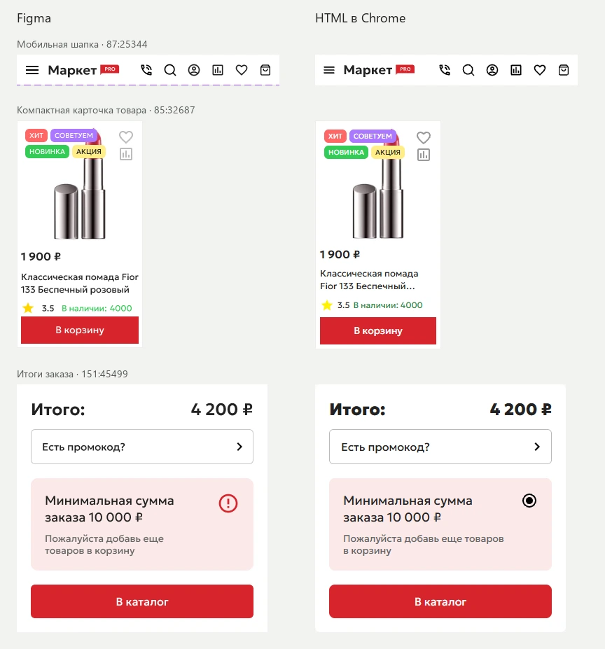

# Дизайн-система Web Comp

В каталоге 62 раздела и 312 образцов. Ссылка в строке открывает нужный вариант. Для секций можно выбрать ширину мастера и включить масштаб 1:1. В узком окне каталог открывается кнопкой «Разделы». [Открыть демонстрацию](http://127.0.0.1:5173/catalog/) · [Принятый реестр](inventory.md).

## Запуск

Проверено на Windows с Node.js 24.21.0 и npm 11.19.0. Из корня проекта выполните `npm ci`, затем одну из команд.

| Команда | Результат |
| --- | --- |
| `npm run dev` | [Локальная разработка](http://127.0.0.1:5173/catalog/) с обновлением при изменениях |
| `npm run build` | Сборка в `dist/` с локальными шрифтами, фотографиями и значками |
| `npm run preview` | [Просмотр собранной версии](http://127.0.0.1:4173/catalog/) после сборки |

## Устройство библиотеки

HTML-страница подключает [входной модуль](../src/main.js). БЭМ-блоки разделены между [элементами управления](../src/styles/_controls.scss), [карточками](../src/styles/_cards.scss) и [секциями](../src/styles/_sections.scss). Палитра, типографика и адаптивные значения вынесены в [общие переменные SCSS](../src/styles/_tokens.scss). Все значения 59 переменных по именованным режимам доступны в [данных каталога](../src/catalog/variables.json).

Функции в [модулях компонентов](../src/components/) возвращают HTML-элементы. Они используются и в самостоятельных образцах, и внутри составных секций. Названия, идентификаторы мастеров и размеры собраны в [реестре вариантов](../src/catalog/families.json). Выбор образца и масштабирование реализованы в [модуле демонстрации](../src/catalog/viewer.js).

Фотографии хранятся в WebP, векторные значки извлечены из SVG Figma. Geologica и Inter поставляются в сборке через Fontsource. Мастера базовых кнопок используют красный акцент. У страницы образцов собственные цвета на Inter, у принятой основной главной синий акцент и Geologica. [Базовые кнопки](http://127.0.0.1:5173/#main-button) · [Кнопки образцов](http://127.0.0.1:5173/#sample-buttons) · [Синяя кнопка](http://127.0.0.1:5173/#theme-button).

## Проверка в браузере

25 ноября 2026 года в Chrome проверены 312 прямых ссылок. Каждая открыла нужный раздел, вариант и ссылку на Figma. На 106 адресах, охватывающих все разделы и все варианты секций, проверена загрузка изображений и отсутствие ошибок JavaScript. В отдельной чистой папке прошли `npm ci` и `npm run build`.

Для 185 видимых вариантов базовых элементов, составных компонентов и секций сопоставлены снимки HTML и экспорты Figma. У нулевого текстового слоя нет площади для снимка. Отдельно по вычисленным стилям проверены ширина, высота, фон и цвет текста 53 полей и 22 кнопок.

В готовой сборке пройдены 12 сценариев. Проверены текст и выбор в полях, отключённые состояния, две темы кнопок, корзина и избранное, диапазон цен и флажки, цвета и размеры, раскрытие отзыва и промокода, закрытие диалога клавишей Escape и возврат фокуса, прокрутка брендов, переключение варианта секции, мобильное меню и поиск, проверка адреса подписки. Горизонтальное переполнение страницы проверено при ширинах 375, 768, 1000, 1200 и 1920 px.

Навигационные действия без адреса показывают локальное пояснение. Поиск в шапке работает по демонстрационному списку категорий. Подписка проверяет формат почты локально. Для отправки подписки нужен обработчик, для воспроизведения видео — медиафайл. Совпадение внешнего вида оценивается по исходным образцам, браузерная отрисовка текста и нативных полей может различаться.

## Указатель образцов

[Основы](#catalog-foundations) · [Элементы управления](#catalog-controls) · [Базовые элементы](#catalog-base) · [Составные компоненты](#catalog-composites) · [Секции](#catalog-sections)

### Основы

#### Шкала шрифтов

[Все варианты](http://127.0.0.1:5173/#typography) · [Группа в Figma](https://www.figma.com/design/SzXvyQnA3KS6fxg8qGOnbm/Web-Comp-3--Copy-?node-id=164%3A65301) · [Реализация](../src/catalog/foundations.js)

| Пример в браузере | Узел Figma |
| --- | --- |
| [Display/Hero 42-110 · 42 px](http://127.0.0.1:5173/#typography/type-display-hero-42-110) | [261-113670](https://www.figma.com/design/SzXvyQnA3KS6fxg8qGOnbm/Web-Comp-3--Copy-?node-id=261-113670) |
| [Heading/H1 32-142 · 32 px](http://127.0.0.1:5173/#typography/type-heading-h1-32-142) | [164-67847](https://www.figma.com/design/SzXvyQnA3KS6fxg8qGOnbm/Web-Comp-3--Copy-?node-id=164-67847) |
| [Heading/H2 28-142 · 28 px](http://127.0.0.1:5173/#typography/type-heading-h2-28-142) | [164-67849](https://www.figma.com/design/SzXvyQnA3KS6fxg8qGOnbm/Web-Comp-3--Copy-?node-id=164-67849) |
| [Heading/H3 24-142 · 24 px](http://127.0.0.1:5173/#typography/type-heading-h3-24-142) | [164-67850](https://www.figma.com/design/SzXvyQnA3KS6fxg8qGOnbm/Web-Comp-3--Copy-?node-id=164-67850) |
| [Heading/H4 20-142 · 20 px](http://127.0.0.1:5173/#typography/type-heading-h4-20-142) | [164-67851](https://www.figma.com/design/SzXvyQnA3KS6fxg8qGOnbm/Web-Comp-3--Copy-?node-id=164-67851) |
| [Heading/H5 18-142 · 18 px](http://127.0.0.1:5173/#typography/type-heading-h5-18-142) | [164-67853](https://www.figma.com/design/SzXvyQnA3KS6fxg8qGOnbm/Web-Comp-3--Copy-?node-id=164-67853) |
| [Heading/H6 16-142 · 16 px](http://127.0.0.1:5173/#typography/type-heading-h6-16-142) | [164-67855](https://www.figma.com/design/SzXvyQnA3KS6fxg8qGOnbm/Web-Comp-3--Copy-?node-id=164-67855) |
| [Body/16 Bold-142 · 16 px](http://127.0.0.1:5173/#typography/type-body-16-bold-142) | [316-395411](https://www.figma.com/design/SzXvyQnA3KS6fxg8qGOnbm/Web-Comp-3--Copy-?node-id=316-395411) |
| [Body/16-142 · 16 px](http://127.0.0.1:5173/#typography/type-body-16-142) | [164-67848](https://www.figma.com/design/SzXvyQnA3KS6fxg8qGOnbm/Web-Comp-3--Copy-?node-id=164-67848) |
| [Body/15-142 · 15 px](http://127.0.0.1:5173/#typography/type-body-15-142) | [69-2334](https://www.figma.com/design/SzXvyQnA3KS6fxg8qGOnbm/Web-Comp-3--Copy-?node-id=69-2334) |
| [Body/14-142 · 14 px](http://127.0.0.1:5173/#typography/type-body-14-142) | [138-40218](https://www.figma.com/design/SzXvyQnA3KS6fxg8qGOnbm/Web-Comp-3--Copy-?node-id=138-40218) |
| [Body/13-142 · 13 px](http://127.0.0.1:5173/#typography/type-body-13-142) | [47-2173](https://www.figma.com/design/SzXvyQnA3KS6fxg8qGOnbm/Web-Comp-3--Copy-?node-id=47-2173) |
| [Body/12-142 · 12 px](http://127.0.0.1:5173/#typography/type-body-12-142) | [65-2073](https://www.figma.com/design/SzXvyQnA3KS6fxg8qGOnbm/Web-Comp-3--Copy-?node-id=65-2073) |
| [Body/18-132 · 18 px](http://127.0.0.1:5173/#typography/type-body-18-132) | [151-45540](https://www.figma.com/design/SzXvyQnA3KS6fxg8qGOnbm/Web-Comp-3--Copy-?node-id=151-45540) |
| [Button/14-21 · 14 px](http://127.0.0.1:5173/#typography/type-button-14-21) | [22-7](https://www.figma.com/design/SzXvyQnA3KS6fxg8qGOnbm/Web-Comp-3--Copy-?node-id=22-7) |
| [Button/15-22 · 15 px](http://127.0.0.1:5173/#typography/type-button-15-22) | [261-115422](https://www.figma.com/design/SzXvyQnA3KS6fxg8qGOnbm/Web-Comp-3--Copy-?node-id=261-115422) |
| [Button/15 Bold-22 · 15 px](http://127.0.0.1:5173/#typography/type-button-15-bold-22) | [316-395411](https://www.figma.com/design/SzXvyQnA3KS6fxg8qGOnbm/Web-Comp-3--Copy-?node-id=316-395411) |
| [Button/16-16 · 16 px](http://127.0.0.1:5173/#typography/type-button-16-16) | [29-865](https://www.figma.com/design/SzXvyQnA3KS6fxg8qGOnbm/Web-Comp-3--Copy-?node-id=29-865) |
| [Price/18 Bold-142 · 18 px](http://127.0.0.1:5173/#typography/type-price-18-bold-142) | [65-2074](https://www.figma.com/design/SzXvyQnA3KS6fxg8qGOnbm/Web-Comp-3--Copy-?node-id=65-2074) |
| [Price/16 Bold-142 · 16 px](http://127.0.0.1:5173/#typography/type-price-16-bold-142) | [85-32699](https://www.figma.com/design/SzXvyQnA3KS6fxg8qGOnbm/Web-Comp-3--Copy-?node-id=85-32699) |
| [Price/24 Bold-142 · 24 px](http://127.0.0.1:5173/#typography/type-price-24-bold-142) | [142-47209](https://www.figma.com/design/SzXvyQnA3KS6fxg8qGOnbm/Web-Comp-3--Copy-?node-id=142-47209) |
| [Label/Uppercase 10-23 · 10 px](http://127.0.0.1:5173/#typography/type-label-uppercase-10-23) | [19-52](https://www.figma.com/design/SzXvyQnA3KS6fxg8qGOnbm/Web-Comp-3--Copy-?node-id=19-52) |

#### Переменные и режимы

[Все варианты](http://127.0.0.1:5173/#variables) · [Группа в Figma](https://www.figma.com/design/SzXvyQnA3KS6fxg8qGOnbm/Web-Comp-3--Copy-?node-id=26%3A278) · [Реализация](../src/catalog/foundations.js)

| Пример в браузере | Узел Figma |
| --- | --- |
| [Светлая и тёмная палитры](http://127.0.0.1:5173/#variables/collection-1) | [26:278](https://www.figma.com/design/SzXvyQnA3KS6fxg8qGOnbm/Web-Comp-3--Copy-?node-id=26%3A278) |
| [Цвета темы](http://127.0.0.1:5173/#variables/collection-2) | [26:278](https://www.figma.com/design/SzXvyQnA3KS6fxg8qGOnbm/Web-Comp-3--Copy-?node-id=26%3A278) |
| [Ширина контейнера](http://127.0.0.1:5173/#variables/collection-3) | [26:278](https://www.figma.com/design/SzXvyQnA3KS6fxg8qGOnbm/Web-Comp-3--Copy-?node-id=26%3A278) |
| [Семейство шрифта](http://127.0.0.1:5173/#variables/collection-4) | [26:278](https://www.figma.com/design/SzXvyQnA3KS6fxg8qGOnbm/Web-Comp-3--Copy-?node-id=26%3A278) |
| [Радиусы кнопок](http://127.0.0.1:5173/#variables/collection-5) | [26:278](https://www.figma.com/design/SzXvyQnA3KS6fxg8qGOnbm/Web-Comp-3--Copy-?node-id=26%3A278) |
| [Типографика и отступы](http://127.0.0.1:5173/#variables/collection-6) | [26:278](https://www.figma.com/design/SzXvyQnA3KS6fxg8qGOnbm/Web-Comp-3--Copy-?node-id=26%3A278) |
| [Начертание заголовков](http://127.0.0.1:5173/#variables/collection-7) | [26:278](https://www.figma.com/design/SzXvyQnA3KS6fxg8qGOnbm/Web-Comp-3--Copy-?node-id=26%3A278) |
| [Радиусы изображений](http://127.0.0.1:5173/#variables/collection-8) | [26:278](https://www.figma.com/design/SzXvyQnA3KS6fxg8qGOnbm/Web-Comp-3--Copy-?node-id=26%3A278) |
| [Радиусы контейнеров](http://127.0.0.1:5173/#variables/collection-9) | [26:278](https://www.figma.com/design/SzXvyQnA3KS6fxg8qGOnbm/Web-Comp-3--Copy-?node-id=26%3A278) |
| [Интервал карточек](http://127.0.0.1:5173/#variables/collection-10) | [26:278](https://www.figma.com/design/SzXvyQnA3KS6fxg8qGOnbm/Web-Comp-3--Copy-?node-id=26%3A278) |
| [Режим баннера](http://127.0.0.1:5173/#variables/collection-11) | [26:278](https://www.figma.com/design/SzXvyQnA3KS6fxg8qGOnbm/Web-Comp-3--Copy-?node-id=26%3A278) |

#### Цитата, отзыв и таблицы

[Все варианты](http://127.0.0.1:5173/#rich-text) · [Группа в Figma](https://www.figma.com/design/SzXvyQnA3KS6fxg8qGOnbm/Web-Comp-3--Copy-?node-id=164%3A67843) · [Реализация](../src/catalog/foundations.js)

| Пример в браузере | Узел Figma |
| --- | --- |
| [Заголовки и абзацы](http://127.0.0.1:5173/#rich-text/164-67846) | [164:67846](https://www.figma.com/design/SzXvyQnA3KS6fxg8qGOnbm/Web-Comp-3--Copy-?node-id=164%3A67846) |
| [Четыре вида списков](http://127.0.0.1:5173/#rich-text/261-113786) | [261:113786](https://www.figma.com/design/SzXvyQnA3KS6fxg8qGOnbm/Web-Comp-3--Copy-?node-id=261%3A113786) |
| [Цитата · текст-заполнитель из макета](http://127.0.0.1:5173/#rich-text/261-113669) | [261:113669](https://www.figma.com/design/SzXvyQnA3KS6fxg8qGOnbm/Web-Comp-3--Copy-?node-id=261%3A113669) |
| [Отзыв в тексте](http://127.0.0.1:5173/#rich-text/261-113666) | [261:113666](https://www.figma.com/design/SzXvyQnA3KS6fxg8qGOnbm/Web-Comp-3--Copy-?node-id=261%3A113666) |
| [Таблица без рамки](http://127.0.0.1:5173/#rich-text/164-68087) | [164:68087](https://www.figma.com/design/SzXvyQnA3KS6fxg8qGOnbm/Web-Comp-3--Copy-?node-id=164%3A68087) |
| [Таблица с рамкой](http://127.0.0.1:5173/#rich-text/164-68126) | [164:68126](https://www.figma.com/design/SzXvyQnA3KS6fxg8qGOnbm/Web-Comp-3--Copy-?node-id=164%3A68126) |
| [Таблица с границей снизу](http://127.0.0.1:5173/#rich-text/164-68166) | [164:68166](https://www.figma.com/design/SzXvyQnA3KS6fxg8qGOnbm/Web-Comp-3--Copy-?node-id=164%3A68166) |
| [Таблица](http://127.0.0.1:5173/#rich-text/164-68189) | [164:68189](https://www.figma.com/design/SzXvyQnA3KS6fxg8qGOnbm/Web-Comp-3--Copy-?node-id=164%3A68189) |
| [Таблица](http://127.0.0.1:5173/#rich-text/164-68259) | [164:68259](https://www.figma.com/design/SzXvyQnA3KS6fxg8qGOnbm/Web-Comp-3--Copy-?node-id=164%3A68259) |

#### Экраны и контейнеры

[Все варианты](http://127.0.0.1:5173/#containers) · [Группа в Figma](https://www.figma.com/design/SzXvyQnA3KS6fxg8qGOnbm/Web-Comp-3--Copy-?node-id=26%3A278) · [Реализация](../src/catalog/foundations.js)

| Пример в браузере | Узел Figma |
| --- | --- |
| [1920 px · контейнер 1500 px](http://127.0.0.1:5173/#containers/frame-24-3854) | [24-3854](https://www.figma.com/design/SzXvyQnA3KS6fxg8qGOnbm/Web-Comp-3--Copy-?node-id=24-3854) |
| [1920 px · контейнер 1296 px](http://127.0.0.1:5173/#containers/frame-74-30210) | [74-30210](https://www.figma.com/design/SzXvyQnA3KS6fxg8qGOnbm/Web-Comp-3--Copy-?node-id=74-30210) |
| [1920 px · контейнер 1696 px](http://127.0.0.1:5173/#containers/frame-26-278) | [26-278](https://www.figma.com/design/SzXvyQnA3KS6fxg8qGOnbm/Web-Comp-3--Copy-?node-id=26-278) |
| [1200 px · контейнер 1120 px](http://127.0.0.1:5173/#containers/frame-74-33368) | [74-33368](https://www.figma.com/design/SzXvyQnA3KS6fxg8qGOnbm/Web-Comp-3--Copy-?node-id=74-33368) |
| [1000 px · контейнер 960 px](http://127.0.0.1:5173/#containers/frame-77-13252) | [77-13252](https://www.figma.com/design/SzXvyQnA3KS6fxg8qGOnbm/Web-Comp-3--Copy-?node-id=77-13252) |
| [768 px · контейнер 728 px](http://127.0.0.1:5173/#containers/frame-77-16410) | [77-16410](https://www.figma.com/design/SzXvyQnA3KS6fxg8qGOnbm/Web-Comp-3--Copy-?node-id=77-16410) |
| [375 px · контейнер 355 px](http://127.0.0.1:5173/#containers/frame-77-19568) | [77-19568](https://www.figma.com/design/SzXvyQnA3KS6fxg8qGOnbm/Web-Comp-3--Copy-?node-id=77-19568) |

### Элементы управления

#### Поля ввода и списки

[Все варианты](http://127.0.0.1:5173/#inputs) · [Группа в Figma](https://www.figma.com/design/SzXvyQnA3KS6fxg8qGOnbm/Web-Comp-3--Copy-?node-id=152%3A48282) · [Реализация](../src/components/fields.js)

| Пример в браузере | Узел Figma |
| --- | --- |
| [Текст · контур · малый · обычное · 140 × 30 px](http://127.0.0.1:5173/#inputs/152-48335) | [152:48335](https://www.figma.com/design/SzXvyQnA3KS6fxg8qGOnbm/Web-Comp-3--Copy-?node-id=152%3A48335) |
| [Текст · контур · малый · отключено · 140 × 30 px](http://127.0.0.1:5173/#inputs/152-48337) | [152:48337](https://www.figma.com/design/SzXvyQnA3KS6fxg8qGOnbm/Web-Comp-3--Copy-?node-id=152%3A48337) |
| [Текст · контур · средний · обычное · 180 × 38 px](http://127.0.0.1:5173/#inputs/152-48333) | [152:48333](https://www.figma.com/design/SzXvyQnA3KS6fxg8qGOnbm/Web-Comp-3--Copy-?node-id=152%3A48333) |
| [Текст · контур · средний · отключено · 180 × 38 px](http://127.0.0.1:5173/#inputs/152-48331) | [152:48331](https://www.figma.com/design/SzXvyQnA3KS6fxg8qGOnbm/Web-Comp-3--Copy-?node-id=152%3A48331) |
| [Текст · контур · большой · обычное · 220 × 48 px](http://127.0.0.1:5173/#inputs/152-48341) | [152:48341](https://www.figma.com/design/SzXvyQnA3KS6fxg8qGOnbm/Web-Comp-3--Copy-?node-id=152%3A48341) |
| [Текст · контур · большой · отключено · 220 × 48 px](http://127.0.0.1:5173/#inputs/152-48339) | [152:48339](https://www.figma.com/design/SzXvyQnA3KS6fxg8qGOnbm/Web-Comp-3--Copy-?node-id=152%3A48339) |
| [Текст · заливка · малый · обычное · 140 × 30 px](http://127.0.0.1:5173/#inputs/152-48315) | [152:48315](https://www.figma.com/design/SzXvyQnA3KS6fxg8qGOnbm/Web-Comp-3--Copy-?node-id=152%3A48315) |
| [Текст · заливка · малый · отключено · 140 × 30 px](http://127.0.0.1:5173/#inputs/152-48313) | [152:48313](https://www.figma.com/design/SzXvyQnA3KS6fxg8qGOnbm/Web-Comp-3--Copy-?node-id=152%3A48313) |
| [Текст · заливка · средний · обычное · 180 × 38 px](http://127.0.0.1:5173/#inputs/152-48322) | [152:48322](https://www.figma.com/design/SzXvyQnA3KS6fxg8qGOnbm/Web-Comp-3--Copy-?node-id=152%3A48322) |
| [Текст · заливка · средний · отключено · 180 × 38 px](http://127.0.0.1:5173/#inputs/152-48320) | [152:48320](https://www.figma.com/design/SzXvyQnA3KS6fxg8qGOnbm/Web-Comp-3--Copy-?node-id=152%3A48320) |
| [Текст · заливка · большой · обычное · 220 × 48 px](http://127.0.0.1:5173/#inputs/152-48329) | [152:48329](https://www.figma.com/design/SzXvyQnA3KS6fxg8qGOnbm/Web-Comp-3--Copy-?node-id=152%3A48329) |
| [Текст · заливка · большой · отключено · 220 × 48 px](http://127.0.0.1:5173/#inputs/152-48327) | [152:48327](https://www.figma.com/design/SzXvyQnA3KS6fxg8qGOnbm/Web-Comp-3--Copy-?node-id=152%3A48327) |
| [Текст · вспомогательное · малый · обычное · 140 × 30 px](http://127.0.0.1:5173/#inputs/152-48300) | [152:48300](https://www.figma.com/design/SzXvyQnA3KS6fxg8qGOnbm/Web-Comp-3--Copy-?node-id=152%3A48300) |
| [Текст · вспомогательное · малый · отключено · 140 × 30 px](http://127.0.0.1:5173/#inputs/152-48298) | [152:48298](https://www.figma.com/design/SzXvyQnA3KS6fxg8qGOnbm/Web-Comp-3--Copy-?node-id=152%3A48298) |
| [Текст · вспомогательное · средний · обычное · 180 × 38 px](http://127.0.0.1:5173/#inputs/152-48304) | [152:48304](https://www.figma.com/design/SzXvyQnA3KS6fxg8qGOnbm/Web-Comp-3--Copy-?node-id=152%3A48304) |
| [Текст · вспомогательное · средний · отключено · 180 × 38 px](http://127.0.0.1:5173/#inputs/152-48302) | [152:48302](https://www.figma.com/design/SzXvyQnA3KS6fxg8qGOnbm/Web-Comp-3--Copy-?node-id=152%3A48302) |
| [Текст · вспомогательное · большой · обычное · 220 × 48 px](http://127.0.0.1:5173/#inputs/152-48311) | [152:48311](https://www.figma.com/design/SzXvyQnA3KS6fxg8qGOnbm/Web-Comp-3--Copy-?node-id=152%3A48311) |
| [Текст · вспомогательное · большой · отключено · 220 × 48 px](http://127.0.0.1:5173/#inputs/152-48306) | [152:48306](https://www.figma.com/design/SzXvyQnA3KS6fxg8qGOnbm/Web-Comp-3--Copy-?node-id=152%3A48306) |
| [Текст · белое · малый · обычное · 140 × 30 px](http://127.0.0.1:5173/#inputs/152-48288) | [152:48288](https://www.figma.com/design/SzXvyQnA3KS6fxg8qGOnbm/Web-Comp-3--Copy-?node-id=152%3A48288) |
| [Текст · белое · малый · отключено · 140 × 30 px](http://127.0.0.1:5173/#inputs/152-48283) | [152:48283](https://www.figma.com/design/SzXvyQnA3KS6fxg8qGOnbm/Web-Comp-3--Copy-?node-id=152%3A48283) |
| [Текст · белое · средний · обычное · 180 × 38 px](http://127.0.0.1:5173/#inputs/152-48292) | [152:48292](https://www.figma.com/design/SzXvyQnA3KS6fxg8qGOnbm/Web-Comp-3--Copy-?node-id=152%3A48292) |
| [Текст · белое · средний · отключено · 180 × 38 px](http://127.0.0.1:5173/#inputs/152-48290) | [152:48290](https://www.figma.com/design/SzXvyQnA3KS6fxg8qGOnbm/Web-Comp-3--Copy-?node-id=152%3A48290) |
| [Текст · белое · большой · обычное · 220 × 48 px](http://127.0.0.1:5173/#inputs/152-48296) | [152:48296](https://www.figma.com/design/SzXvyQnA3KS6fxg8qGOnbm/Web-Comp-3--Copy-?node-id=152%3A48296) |
| [Текст · белое · большой · отключено · 220 × 48 px](http://127.0.0.1:5173/#inputs/152-48294) | [152:48294](https://www.figma.com/design/SzXvyQnA3KS6fxg8qGOnbm/Web-Comp-3--Copy-?node-id=152%3A48294) |
| [Список · контур · малый · обычное · 140 × 30 px](http://127.0.0.1:5173/#inputs/152-48388) | [152:48388](https://www.figma.com/design/SzXvyQnA3KS6fxg8qGOnbm/Web-Comp-3--Copy-?node-id=152%3A48388) |
| [Список · контур · малый · отключено · 140 × 30 px](http://127.0.0.1:5173/#inputs/152-48385) | [152:48385](https://www.figma.com/design/SzXvyQnA3KS6fxg8qGOnbm/Web-Comp-3--Copy-?node-id=152%3A48385) |
| [Список · контур · средний · обычное · 180 × 38 px](http://127.0.0.1:5173/#inputs/152-48394) | [152:48394](https://www.figma.com/design/SzXvyQnA3KS6fxg8qGOnbm/Web-Comp-3--Copy-?node-id=152%3A48394) |
| [Список · контур · средний · отключено · 180 × 38 px](http://127.0.0.1:5173/#inputs/152-48391) | [152:48391](https://www.figma.com/design/SzXvyQnA3KS6fxg8qGOnbm/Web-Comp-3--Copy-?node-id=152%3A48391) |
| [Список · контур · большой · обычное · 220 × 48 px](http://127.0.0.1:5173/#inputs/152-48400) | [152:48400](https://www.figma.com/design/SzXvyQnA3KS6fxg8qGOnbm/Web-Comp-3--Copy-?node-id=152%3A48400) |
| [Список · контур · большой · отключено · 220 × 48 px](http://127.0.0.1:5173/#inputs/152-48397) | [152:48397](https://www.figma.com/design/SzXvyQnA3KS6fxg8qGOnbm/Web-Comp-3--Copy-?node-id=152%3A48397) |
| [Список · заливка · малый · обычное · 140 × 30 px](http://127.0.0.1:5173/#inputs/152-48317) | [152:48317](https://www.figma.com/design/SzXvyQnA3KS6fxg8qGOnbm/Web-Comp-3--Copy-?node-id=152%3A48317) |
| [Список · заливка · малый · отключено · 140 × 30 px](http://127.0.0.1:5173/#inputs/152-48373) | [152:48373](https://www.figma.com/design/SzXvyQnA3KS6fxg8qGOnbm/Web-Comp-3--Copy-?node-id=152%3A48373) |
| [Список · заливка · средний · обычное · 180 × 38 px](http://127.0.0.1:5173/#inputs/152-48324) | [152:48324](https://www.figma.com/design/SzXvyQnA3KS6fxg8qGOnbm/Web-Comp-3--Copy-?node-id=152%3A48324) |
| [Список · заливка · средний · отключено · 180 × 38 px](http://127.0.0.1:5173/#inputs/152-48376) | [152:48376](https://www.figma.com/design/SzXvyQnA3KS6fxg8qGOnbm/Web-Comp-3--Copy-?node-id=152%3A48376) |
| [Список · заливка · большой · обычное · 220 × 48 px](http://127.0.0.1:5173/#inputs/152-48382) | [152:48382](https://www.figma.com/design/SzXvyQnA3KS6fxg8qGOnbm/Web-Comp-3--Copy-?node-id=152%3A48382) |
| [Список · заливка · большой · отключено · 220 × 48 px](http://127.0.0.1:5173/#inputs/152-48379) | [152:48379](https://www.figma.com/design/SzXvyQnA3KS6fxg8qGOnbm/Web-Comp-3--Copy-?node-id=152%3A48379) |
| [Список · вспомогательное · малый · обычное · 140 × 30 px](http://127.0.0.1:5173/#inputs/152-48361) | [152:48361](https://www.figma.com/design/SzXvyQnA3KS6fxg8qGOnbm/Web-Comp-3--Copy-?node-id=152%3A48361) |
| [Список · вспомогательное · малый · отключено · 140 × 30 px](http://127.0.0.1:5173/#inputs/152-48358) | [152:48358](https://www.figma.com/design/SzXvyQnA3KS6fxg8qGOnbm/Web-Comp-3--Copy-?node-id=152%3A48358) |
| [Список · вспомогательное · средний · обычное · 180 × 38 px](http://127.0.0.1:5173/#inputs/152-48367) | [152:48367](https://www.figma.com/design/SzXvyQnA3KS6fxg8qGOnbm/Web-Comp-3--Copy-?node-id=152%3A48367) |
| [Список · вспомогательное · средний · отключено · 180 × 38 px](http://127.0.0.1:5173/#inputs/152-48364) | [152:48364](https://www.figma.com/design/SzXvyQnA3KS6fxg8qGOnbm/Web-Comp-3--Copy-?node-id=152%3A48364) |
| [Список · вспомогательное · большой · обычное · 220 × 48 px](http://127.0.0.1:5173/#inputs/152-48370) | [152:48370](https://www.figma.com/design/SzXvyQnA3KS6fxg8qGOnbm/Web-Comp-3--Copy-?node-id=152%3A48370) |
| [Список · вспомогательное · большой · отключено · 220 × 48 px](http://127.0.0.1:5173/#inputs/152-48308) | [152:48308](https://www.figma.com/design/SzXvyQnA3KS6fxg8qGOnbm/Web-Comp-3--Copy-?node-id=152%3A48308) |
| [Список · белое · малый · обычное · 140 × 30 px](http://127.0.0.1:5173/#inputs/152-48343) | [152:48343](https://www.figma.com/design/SzXvyQnA3KS6fxg8qGOnbm/Web-Comp-3--Copy-?node-id=152%3A48343) |
| [Список · белое · малый · отключено · 140 × 30 px](http://127.0.0.1:5173/#inputs/152-48285) | [152:48285](https://www.figma.com/design/SzXvyQnA3KS6fxg8qGOnbm/Web-Comp-3--Copy-?node-id=152%3A48285) |
| [Список · белое · средний · обычное · 180 × 38 px](http://127.0.0.1:5173/#inputs/152-48349) | [152:48349](https://www.figma.com/design/SzXvyQnA3KS6fxg8qGOnbm/Web-Comp-3--Copy-?node-id=152%3A48349) |
| [Список · белое · средний · отключено · 180 × 38 px](http://127.0.0.1:5173/#inputs/152-48346) | [152:48346](https://www.figma.com/design/SzXvyQnA3KS6fxg8qGOnbm/Web-Comp-3--Copy-?node-id=152%3A48346) |
| [Список · белое · большой · обычное · 220 × 48 px](http://127.0.0.1:5173/#inputs/152-48355) | [152:48355](https://www.figma.com/design/SzXvyQnA3KS6fxg8qGOnbm/Web-Comp-3--Copy-?node-id=152%3A48355) |
| [Список · белое · большой · отключено · 220 × 48 px](http://127.0.0.1:5173/#inputs/152-48352) | [152:48352](https://www.figma.com/design/SzXvyQnA3KS6fxg8qGOnbm/Web-Comp-3--Copy-?node-id=152%3A48352) |
| [Поиск 1 · контур · малый · обычное · 140 × 30 px](http://127.0.0.1:5173/#inputs/152-48419) | [152:48419](https://www.figma.com/design/SzXvyQnA3KS6fxg8qGOnbm/Web-Comp-3--Copy-?node-id=152%3A48419) |
| [Поиск 1 · контур · средний · обычное · 180 × 38 px](http://127.0.0.1:5173/#inputs/152-48416) | [152:48416](https://www.figma.com/design/SzXvyQnA3KS6fxg8qGOnbm/Web-Comp-3--Copy-?node-id=152%3A48416) |
| [Поиск 1 · контур · большой · обычное · 220 × 48 px](http://127.0.0.1:5173/#inputs/152-48403) | [152:48403](https://www.figma.com/design/SzXvyQnA3KS6fxg8qGOnbm/Web-Comp-3--Copy-?node-id=152%3A48403) |
| [Поиск 2 · контур · средний · обычное · 180 × 38 px](http://127.0.0.1:5173/#inputs/152-48411) | [152:48411](https://www.figma.com/design/SzXvyQnA3KS6fxg8qGOnbm/Web-Comp-3--Copy-?node-id=152%3A48411) |
| [Поиск 2 · контур · большой · обычное · 220 × 48 px](http://127.0.0.1:5173/#inputs/152-48406) | [152:48406](https://www.figma.com/design/SzXvyQnA3KS6fxg8qGOnbm/Web-Comp-3--Copy-?node-id=152%3A48406) |

#### Кнопки страницы образцов

[Все варианты](http://127.0.0.1:5173/#sample-buttons) · [Группа в Figma](https://www.figma.com/design/SzXvyQnA3KS6fxg8qGOnbm/Web-Comp-3--Copy-?node-id=74%3A27675) · [Реализация](../src/components/fields.js)

| Пример в браузере | Узел Figma |
| --- | --- |
| [Оформление · Default · 94,5 × 42 px](http://127.0.0.1:5173/#sample-buttons/74-27693) | [74:27693](https://www.figma.com/design/SzXvyQnA3KS6fxg8qGOnbm/Web-Comp-3--Copy-?node-id=74%3A27693) |
| [Оформление · Primary · 98,8 × 42 px](http://127.0.0.1:5173/#sample-buttons/74-27695) | [74:27695](https://www.figma.com/design/SzXvyQnA3KS6fxg8qGOnbm/Web-Comp-3--Copy-?node-id=74%3A27695) |
| [Оформление · Success · 103,77 × 42 px](http://127.0.0.1:5173/#sample-buttons/74-27697) | [74:27697](https://www.figma.com/design/SzXvyQnA3KS6fxg8qGOnbm/Web-Comp-3--Copy-?node-id=74%3A27697) |
| [Оформление · Info · 69,94 × 42 px](http://127.0.0.1:5173/#sample-buttons/74-27699) | [74:27699](https://www.figma.com/design/SzXvyQnA3KS6fxg8qGOnbm/Web-Comp-3--Copy-?node-id=74%3A27699) |
| [Оформление · Warning · 102,86 × 42 px](http://127.0.0.1:5173/#sample-buttons/74-27701) | [74:27701](https://www.figma.com/design/SzXvyQnA3KS6fxg8qGOnbm/Web-Comp-3--Copy-?node-id=74%3A27701) |
| [Оформление · Danger · 94,84 × 42 px](http://127.0.0.1:5173/#sample-buttons/74-27703) | [74:27703](https://www.figma.com/design/SzXvyQnA3KS6fxg8qGOnbm/Web-Comp-3--Copy-?node-id=74%3A27703) |
| [Оформление · Transparent · 130 × 42 px](http://127.0.0.1:5173/#sample-buttons/74-27705) | [74:27705](https://www.figma.com/design/SzXvyQnA3KS6fxg8qGOnbm/Web-Comp-3--Copy-?node-id=74%3A27705) |
| [Оформление · Transparent with border · 216,89 × 42 px](http://127.0.0.1:5173/#sample-buttons/74-27707) | [74:27707](https://www.figma.com/design/SzXvyQnA3KS6fxg8qGOnbm/Web-Comp-3--Copy-?node-id=74%3A27707) |
| [Оформление · Transparent border · 182,08 × 42 px](http://127.0.0.1:5173/#sample-buttons/74-27709) | [74:27709](https://www.figma.com/design/SzXvyQnA3KS6fxg8qGOnbm/Web-Comp-3--Copy-?node-id=74%3A27709) |
| [Оформление · Link · 72,13 × 42 px](http://127.0.0.1:5173/#sample-buttons/74-27711) | [74:27711](https://www.figma.com/design/SzXvyQnA3KS6fxg8qGOnbm/Web-Comp-3--Copy-?node-id=74%3A27711) |
| [Отключена · Default Button · 146,02 × 42 px](http://127.0.0.1:5173/#sample-buttons/74-27714) | [74:27714](https://www.figma.com/design/SzXvyQnA3KS6fxg8qGOnbm/Web-Comp-3--Copy-?node-id=74%3A27714) |
| [Отключена · Primary button · 149,77 × 42 px](http://127.0.0.1:5173/#sample-buttons/74-27716) | [74:27716](https://www.figma.com/design/SzXvyQnA3KS6fxg8qGOnbm/Web-Comp-3--Copy-?node-id=74%3A27716) |
| [Размер · 51 px · заливка · 195,92 × 51 px](http://127.0.0.1:5173/#sample-buttons/74-27720) | [74:27720](https://www.figma.com/design/SzXvyQnA3KS6fxg8qGOnbm/Web-Comp-3--Copy-?node-id=74%3A27720) |
| [Размер · 51 px · контур · 195,92 × 51 px](http://127.0.0.1:5173/#sample-buttons/74-27722) | [74:27722](https://www.figma.com/design/SzXvyQnA3KS6fxg8qGOnbm/Web-Comp-3--Copy-?node-id=74%3A27722) |
| [Размер · 47 px · заливка · 148,08 × 47 px](http://127.0.0.1:5173/#sample-buttons/74-27724) | [74:27724](https://www.figma.com/design/SzXvyQnA3KS6fxg8qGOnbm/Web-Comp-3--Copy-?node-id=74%3A27724) |
| [Размер · 47 px · контур · 148,08 × 47 px](http://127.0.0.1:5173/#sample-buttons/74-27726) | [74:27726](https://www.figma.com/design/SzXvyQnA3KS6fxg8qGOnbm/Web-Comp-3--Copy-?node-id=74%3A27726) |
| [Размер · 42 px · заливка · 145,48 × 42 px](http://127.0.0.1:5173/#sample-buttons/74-27728) | [74:27728](https://www.figma.com/design/SzXvyQnA3KS6fxg8qGOnbm/Web-Comp-3--Copy-?node-id=74%3A27728) |
| [Размер · 42 px · контур · 145,48 × 42 px](http://127.0.0.1:5173/#sample-buttons/74-27730) | [74:27730](https://www.figma.com/design/SzXvyQnA3KS6fxg8qGOnbm/Web-Comp-3--Copy-?node-id=74%3A27730) |
| [Размер · 35 px · заливка · 118,66 × 35 px](http://127.0.0.1:5173/#sample-buttons/74-27732) | [74:27732](https://www.figma.com/design/SzXvyQnA3KS6fxg8qGOnbm/Web-Comp-3--Copy-?node-id=74%3A27732) |
| [Размер · 35 px · контур · 118,66 × 35 px](http://127.0.0.1:5173/#sample-buttons/74-27734) | [74:27734](https://www.figma.com/design/SzXvyQnA3KS6fxg8qGOnbm/Web-Comp-3--Copy-?node-id=74%3A27734) |
| [Размер · 29 px · заливка · 141,14 × 29 px](http://127.0.0.1:5173/#sample-buttons/74-27736) | [74:27736](https://www.figma.com/design/SzXvyQnA3KS6fxg8qGOnbm/Web-Comp-3--Copy-?node-id=74%3A27736) |
| [Размер · 29 px · контур · 141,14 × 29 px](http://127.0.0.1:5173/#sample-buttons/74-27738) | [74:27738](https://www.figma.com/design/SzXvyQnA3KS6fxg8qGOnbm/Web-Comp-3--Copy-?node-id=74%3A27738) |

#### Кнопка синей темы

[Все варианты](http://127.0.0.1:5173/#theme-button) · [Группа в Figma](https://www.figma.com/design/SzXvyQnA3KS6fxg8qGOnbm/Web-Comp-3--Copy-?node-id=I26%3A630%3B32%3A1116%3B32%3A1105) · [Реализация](../src/catalog/foundations.js)

| Пример в браузере | Узел Figma |
| --- | --- |
| [Синяя тема · Geologica](http://127.0.0.1:5173/#theme-button/theme-blue) | [I26:630;32:1116;32:1105](https://www.figma.com/design/SzXvyQnA3KS6fxg8qGOnbm/Web-Comp-3--Copy-?node-id=I26%3A630%3B32%3A1116%3B32%3A1105) |

### Базовые элементы

#### Логотип магазина

[Все варианты](http://127.0.0.1:5173/#logo) · [Группа в Figma](https://www.figma.com/design/SzXvyQnA3KS6fxg8qGOnbm/Web-Comp-3--Copy-?node-id=29%3A920) · [Реализация](../src/components/base.js)

| Пример в браузере | Узел Figma |
| --- | --- |
| [Логотип магазина · 170 × 40 px](http://127.0.0.1:5173/#logo/29-920) | [29:920](https://www.figma.com/design/SzXvyQnA3KS6fxg8qGOnbm/Web-Comp-3--Copy-?node-id=29%3A920) |

#### Основное действие

[Все варианты](http://127.0.0.1:5173/#main-button) · [Группа в Figma](https://www.figma.com/design/SzXvyQnA3KS6fxg8qGOnbm/Web-Comp-3--Copy-?node-id=11%3A5) · [Реализация](../src/components/base.js)

| Пример в браузере | Узел Figma |
| --- | --- |
| [Вариант 1 · 116 × 44 px](http://127.0.0.1:5173/#main-button/29-864) | [29:864](https://www.figma.com/design/SzXvyQnA3KS6fxg8qGOnbm/Web-Comp-3--Copy-?node-id=29%3A864) |
| [Со значком · 138 × 44 px](http://127.0.0.1:5173/#main-button/29-885) | [29:885](https://www.figma.com/design/SzXvyQnA3KS6fxg8qGOnbm/Web-Comp-3--Copy-?node-id=29%3A885) |
| [Второстепенная · 119 × 44 px](http://127.0.0.1:5173/#main-button/24-10464) | [24:10464](https://www.figma.com/design/SzXvyQnA3KS6fxg8qGOnbm/Web-Comp-3--Copy-?node-id=24%3A10464) |

#### Компактная кнопка

[Все варианты](http://127.0.0.1:5173/#small-button) · [Группа в Figma](https://www.figma.com/design/SzXvyQnA3KS6fxg8qGOnbm/Web-Comp-3--Copy-?node-id=22%3A9) · [Реализация](../src/components/base.js)

| Пример в браузере | Узел Figma |
| --- | --- |
| [Основной · 104 × 34 px](http://127.0.0.1:5173/#small-button/22-8) | [22:8](https://www.figma.com/design/SzXvyQnA3KS6fxg8qGOnbm/Web-Comp-3--Copy-?node-id=22%3A8) |
| [Серая · 104 × 34 px](http://127.0.0.1:5173/#small-button/24-10396) | [24:10396](https://www.figma.com/design/SzXvyQnA3KS6fxg8qGOnbm/Web-Comp-3--Copy-?node-id=24%3A10396) |

#### Пиктограммы интерфейса

[Все варианты](http://127.0.0.1:5173/#icon) · [Группа в Figma](https://www.figma.com/design/SzXvyQnA3KS6fxg8qGOnbm/Web-Comp-3--Copy-?node-id=24%3A11) · [Реализация](../src/components/base.js)

| Пример в браузере | Узел Figma |
| --- | --- |
| [Star · 24 × 24 px](http://127.0.0.1:5173/#icon/24-10) | [24:10](https://www.figma.com/design/SzXvyQnA3KS6fxg8qGOnbm/Web-Comp-3--Copy-?node-id=24%3A10) |
| [Star2 · 24 × 24 px](http://127.0.0.1:5173/#icon/24-12) | [24:12](https://www.figma.com/design/SzXvyQnA3KS6fxg8qGOnbm/Web-Comp-3--Copy-?node-id=24%3A12) |
| [heart_outline · 24 × 24 px](http://127.0.0.1:5173/#icon/24-26) | [24:26](https://www.figma.com/design/SzXvyQnA3KS6fxg8qGOnbm/Web-Comp-3--Copy-?node-id=24%3A26) |
| [chart-box-outline · 24 × 24 px](http://127.0.0.1:5173/#icon/24-39) | [24:39](https://www.figma.com/design/SzXvyQnA3KS6fxg8qGOnbm/Web-Comp-3--Copy-?node-id=24%3A39) |
| [chevron-right · 24 × 24 px](http://127.0.0.1:5173/#icon/24-7769) | [24:7769](https://www.figma.com/design/SzXvyQnA3KS6fxg8qGOnbm/Web-Comp-3--Copy-?node-id=24%3A7769) |
| [menu · 24 × 24 px](http://127.0.0.1:5173/#icon/29-860) | [29:860](https://www.figma.com/design/SzXvyQnA3KS6fxg8qGOnbm/Web-Comp-3--Copy-?node-id=29%3A860) |
| [Variant7 · 24 × 24 px](http://127.0.0.1:5173/#icon/29-869) | [29:869](https://www.figma.com/design/SzXvyQnA3KS6fxg8qGOnbm/Web-Comp-3--Copy-?node-id=29%3A869) |
| [chevron-down · 24 × 24 px](http://127.0.0.1:5173/#icon/29-905) | [29:905](https://www.figma.com/design/SzXvyQnA3KS6fxg8qGOnbm/Web-Comp-3--Copy-?node-id=29%3A905) |
| [search · 24 × 24 px](http://127.0.0.1:5173/#icon/29-938) | [29:938](https://www.figma.com/design/SzXvyQnA3KS6fxg8qGOnbm/Web-Comp-3--Copy-?node-id=29%3A938) |
| [navigation-variant-outline · 24 × 24 px](http://127.0.0.1:5173/#icon/30-947) | [30:947](https://www.figma.com/design/SzXvyQnA3KS6fxg8qGOnbm/Web-Comp-3--Copy-?node-id=30%3A947) |
| [weather-sunny · 24 × 24 px](http://127.0.0.1:5173/#icon/30-959) | [30:959](https://www.figma.com/design/SzXvyQnA3KS6fxg8qGOnbm/Web-Comp-3--Copy-?node-id=30%3A959) |
| [weather-night · 24 × 24 px](http://127.0.0.1:5173/#icon/30-962) | [30:962](https://www.figma.com/design/SzXvyQnA3KS6fxg8qGOnbm/Web-Comp-3--Copy-?node-id=30%3A962) |
| [account-circle-outline · 24 × 24 px](http://127.0.0.1:5173/#icon/30-987) | [30:987](https://www.figma.com/design/SzXvyQnA3KS6fxg8qGOnbm/Web-Comp-3--Copy-?node-id=30%3A987) |
| [shopping-bag · 24 × 24 px](http://127.0.0.1:5173/#icon/30-1001) | [30:1001](https://www.figma.com/design/SzXvyQnA3KS6fxg8qGOnbm/Web-Comp-3--Copy-?node-id=30%3A1001) |
| [chevron-left · 24 × 24 px](http://127.0.0.1:5173/#icon/46-1998) | [46:1998](https://www.figma.com/design/SzXvyQnA3KS6fxg8qGOnbm/Web-Comp-3--Copy-?node-id=46%3A1998) |
| [fire · 24 × 24 px](http://127.0.0.1:5173/#icon/69-2348) | [69:2348](https://www.figma.com/design/SzXvyQnA3KS6fxg8qGOnbm/Web-Comp-3--Copy-?node-id=69%3A2348) |
| [phone-in-talk-outline · 24 × 24 px](http://127.0.0.1:5173/#icon/87-24914) | [87:24914](https://www.figma.com/design/SzXvyQnA3KS6fxg8qGOnbm/Web-Comp-3--Copy-?node-id=87%3A24914) |
| [format-list-bulleted-square · 24 × 24 px](http://127.0.0.1:5173/#icon/130-38971) | [130:38971](https://www.figma.com/design/SzXvyQnA3KS6fxg8qGOnbm/Web-Comp-3--Copy-?node-id=130%3A38971) |
| [Variant19 · 24 × 24 px](http://127.0.0.1:5173/#icon/134-39625) | [134:39625](https://www.figma.com/design/SzXvyQnA3KS6fxg8qGOnbm/Web-Comp-3--Copy-?node-id=134%3A39625) |
| [Holder · 24 × 24 px](http://127.0.0.1:5173/#icon/134-39642) | [134:39642](https://www.figma.com/design/SzXvyQnA3KS6fxg8qGOnbm/Web-Comp-3--Copy-?node-id=134%3A39642) |
| [Variant33 · 24 × 24 px](http://127.0.0.1:5173/#icon/231-91950) | [231:91950](https://www.figma.com/design/SzXvyQnA3KS6fxg8qGOnbm/Web-Comp-3--Copy-?node-id=231%3A91950) |
| [Variant30 · 24 × 24 px](http://127.0.0.1:5173/#icon/159-47250) | [159:47250](https://www.figma.com/design/SzXvyQnA3KS6fxg8qGOnbm/Web-Comp-3--Copy-?node-id=159%3A47250) |
| [checkbox-blank-outline · 24 × 24 px](http://127.0.0.1:5173/#icon/136-39752) | [136:39752](https://www.figma.com/design/SzXvyQnA3KS6fxg8qGOnbm/Web-Comp-3--Copy-?node-id=136%3A39752) |
| [Color · 24 × 24 px](http://127.0.0.1:5173/#icon/138-39963) | [138:39963](https://www.figma.com/design/SzXvyQnA3KS6fxg8qGOnbm/Web-Comp-3--Copy-?node-id=138%3A39963) |
| [Size · 28 × 24 px](http://127.0.0.1:5173/#icon/138-40216) | [138:40216](https://www.figma.com/design/SzXvyQnA3KS6fxg8qGOnbm/Web-Comp-3--Copy-?node-id=138%3A40216) |
| [play · 24 × 24 px](http://127.0.0.1:5173/#icon/141-45978) | [141:45978](https://www.figma.com/design/SzXvyQnA3KS6fxg8qGOnbm/Web-Comp-3--Copy-?node-id=141%3A45978) |
| [Variant25 · 24 × 24 px](http://127.0.0.1:5173/#icon/150-44953) | [150:44953](https://www.figma.com/design/SzXvyQnA3KS6fxg8qGOnbm/Web-Comp-3--Copy-?node-id=150%3A44953) |
| [Variant26 · 24 × 24 px](http://127.0.0.1:5173/#icon/151-45547) | [151:45547](https://www.figma.com/design/SzXvyQnA3KS6fxg8qGOnbm/Web-Comp-3--Copy-?node-id=151%3A45547) |
| [tray-arrow-down · 24 × 24 px](http://127.0.0.1:5173/#icon/151-45581) | [151:45581](https://www.figma.com/design/SzXvyQnA3KS6fxg8qGOnbm/Web-Comp-3--Copy-?node-id=151%3A45581) |
| [printer-outline · 24 × 24 px](http://127.0.0.1:5173/#icon/151-45584) | [151:45584](https://www.figma.com/design/SzXvyQnA3KS6fxg8qGOnbm/Web-Comp-3--Copy-?node-id=151%3A45584) |
| [export-variant · 24 × 24 px](http://127.0.0.1:5173/#icon/151-45587) | [151:45587](https://www.figma.com/design/SzXvyQnA3KS6fxg8qGOnbm/Web-Comp-3--Copy-?node-id=151%3A45587) |
| [Variant31 · 24 × 24 px](http://127.0.0.1:5173/#icon/159-47700) | [159:47700](https://www.figma.com/design/SzXvyQnA3KS6fxg8qGOnbm/Web-Comp-3--Copy-?node-id=159%3A47700) |
| [Variant32 · 24 × 24 px](http://127.0.0.1:5173/#icon/159-47882) | [159:47882](https://www.figma.com/design/SzXvyQnA3KS6fxg8qGOnbm/Web-Comp-3--Copy-?node-id=159%3A47882) |
| [close · 24 × 24 px](http://127.0.0.1:5173/#icon/250-118410) | [250:118410](https://www.figma.com/design/SzXvyQnA3KS6fxg8qGOnbm/Web-Comp-3--Copy-?node-id=250%3A118410) |
| [Plus · 24 × 24 px](http://127.0.0.1:5173/#icon/250-118881) | [250:118881](https://www.figma.com/design/SzXvyQnA3KS6fxg8qGOnbm/Web-Comp-3--Copy-?node-id=250%3A118881) |
| [Variant36 · 24 × 24 px](http://127.0.0.1:5173/#icon/250-132281) | [250:132281](https://www.figma.com/design/SzXvyQnA3KS6fxg8qGOnbm/Web-Comp-3--Copy-?node-id=250%3A132281) |
| [Filter_Stroke · 24 × 24 px](http://127.0.0.1:5173/#icon/267-155651) | [267:155651](https://www.figma.com/design/SzXvyQnA3KS6fxg8qGOnbm/Web-Comp-3--Copy-?node-id=267%3A155651) |
| [Filter_Filled · 24 × 24 px](http://127.0.0.1:5173/#icon/267-155671) | [267:155671](https://www.figma.com/design/SzXvyQnA3KS6fxg8qGOnbm/Web-Comp-3--Copy-?node-id=267%3A155671) |

#### Товарная метка

[Все варианты](http://127.0.0.1:5173/#badge) · [Группа в Figma](https://www.figma.com/design/SzXvyQnA3KS6fxg8qGOnbm/Web-Comp-3--Copy-?node-id=24%3A44) · [Реализация](../src/components/base.js)

| Пример в браузере | Узел Figma |
| --- | --- |
| [Хит · 32 × 19 px](http://127.0.0.1:5173/#badge/19-87) | [19:87](https://www.figma.com/design/SzXvyQnA3KS6fxg8qGOnbm/Web-Comp-3--Copy-?node-id=19%3A87) |
| [Советуем · 67 × 19 px](http://127.0.0.1:5173/#badge/24-74) | [24:74](https://www.figma.com/design/SzXvyQnA3KS6fxg8qGOnbm/Web-Comp-3--Copy-?node-id=24%3A74) |
| [Новинка · 63 × 19 px](http://127.0.0.1:5173/#badge/24-76) | [24:76](https://www.figma.com/design/SzXvyQnA3KS6fxg8qGOnbm/Web-Comp-3--Copy-?node-id=24%3A76) |
| [Акция · 48 × 19 px](http://127.0.0.1:5173/#badge/24-78) | [24:78](https://www.figma.com/design/SzXvyQnA3KS6fxg8qGOnbm/Web-Comp-3--Copy-?node-id=24%3A78) |

#### Миниатюра товара в подборке

[Все варианты](http://127.0.0.1:5173/#thumbnail) · [Группа в Figma](https://www.figma.com/design/SzXvyQnA3KS6fxg8qGOnbm/Web-Comp-3--Copy-?node-id=65%3A1774) · [Реализация](../src/components/base.js)

| Пример в браузере | Узел Figma |
| --- | --- |
| [Миниатюра товара в подборке · 133 × 133 px](http://127.0.0.1:5173/#thumbnail/65-1774) | [65:1774](https://www.figma.com/design/SzXvyQnA3KS6fxg8qGOnbm/Web-Comp-3--Copy-?node-id=65%3A1774) |

#### Пиктограмма преимущества

[Все варианты](http://127.0.0.1:5173/#benefit-icon) · [Группа в Figma](https://www.figma.com/design/SzXvyQnA3KS6fxg8qGOnbm/Web-Comp-3--Copy-?node-id=73%3A3583) · [Реализация](../src/components/base.js)

| Пример в браузере | Узел Figma |
| --- | --- |
| [Основной · 40 × 40 px](http://127.0.0.1:5173/#benefit-icon/72-3474) | [72:3474](https://www.figma.com/design/SzXvyQnA3KS6fxg8qGOnbm/Web-Comp-3--Copy-?node-id=72%3A3474) |
| [Link → Wheel · 40 × 40 px](http://127.0.0.1:5173/#benefit-icon/73-3603) | [73:3603](https://www.figma.com/design/SzXvyQnA3KS6fxg8qGOnbm/Web-Comp-3--Copy-?node-id=73%3A3603) |
| [Percent · 40 × 40 px](http://127.0.0.1:5173/#benefit-icon/73-3604) | [73:3604](https://www.figma.com/design/SzXvyQnA3KS6fxg8qGOnbm/Web-Comp-3--Copy-?node-id=73%3A3604) |
| [Sale · 40 × 40 px](http://127.0.0.1:5173/#benefit-icon/73-3605) | [73:3605](https://www.figma.com/design/SzXvyQnA3KS6fxg8qGOnbm/Web-Comp-3--Copy-?node-id=73%3A3605) |

#### Ссылка главного меню

[Все варианты](http://127.0.0.1:5173/#menu-link) · [Группа в Figma](https://www.figma.com/design/SzXvyQnA3KS6fxg8qGOnbm/Web-Comp-3--Copy-?node-id=261%3A114281) · [Реализация](../src/components/base.js)

| Пример в браузере | Узел Figma |
| --- | --- |
| [High_Chevron · 85 × 49 px](http://127.0.0.1:5173/#menu-link/261-114279) | [261:114279](https://www.figma.com/design/SzXvyQnA3KS6fxg8qGOnbm/Web-Comp-3--Copy-?node-id=261%3A114279) |
| [Tall_Chevron · 67 × 21 px](http://127.0.0.1:5173/#menu-link/261-115681) | [261:115681](https://www.figma.com/design/SzXvyQnA3KS6fxg8qGOnbm/Web-Comp-3--Copy-?node-id=261%3A115681) |
| [High_Clean · 71 × 49 px](http://127.0.0.1:5173/#menu-link/261-114282) | [261:114282](https://www.figma.com/design/SzXvyQnA3KS6fxg8qGOnbm/Web-Comp-3--Copy-?node-id=261%3A114282) |
| [Tall_Clean · 50 × 22 px](http://127.0.0.1:5173/#menu-link/261-115421) | [261:115421](https://www.figma.com/design/SzXvyQnA3KS6fxg8qGOnbm/Web-Comp-3--Copy-?node-id=261%3A115421) |

#### Обведённая метка или буква

[Все варианты](http://127.0.0.1:5173/#tag) · [Группа в Figma](https://www.figma.com/design/SzXvyQnA3KS6fxg8qGOnbm/Web-Comp-3--Copy-?node-id=285%3A280634) · [Реализация](../src/components/base.js)

| Пример в браузере | Узел Figma |
| --- | --- |
| [Border_Label · 92 × 37 px](http://127.0.0.1:5173/#tag/264-114507) | [264:114507](https://www.figma.com/design/SzXvyQnA3KS6fxg8qGOnbm/Web-Comp-3--Copy-?node-id=264%3A114507) |
| [Border_letter · 33,39 × 36 px](http://127.0.0.1:5173/#tag/285-277948) | [285:277948](https://www.figma.com/design/SzXvyQnA3KS6fxg8qGOnbm/Web-Comp-3--Copy-?node-id=285%3A277948) |

#### Строки списков

[Все варианты](http://127.0.0.1:5173/#list) · [Группа в Figma](https://www.figma.com/design/SzXvyQnA3KS6fxg8qGOnbm/Web-Comp-3--Copy-?node-id=261%3A113704) · [Реализация](../src/components/base.js)

| Пример в браузере | Узел Figma |
| --- | --- |
| [Маркированный · 596 × 23 px](http://127.0.0.1:5173/#list/261-113678) | [261:113678](https://www.figma.com/design/SzXvyQnA3KS6fxg8qGOnbm/Web-Comp-3--Copy-?node-id=261%3A113678) |
| [Нумерованный · 596 × 23 px](http://127.0.0.1:5173/#list/261-113705) | [261:113705](https://www.figma.com/design/SzXvyQnA3KS6fxg8qGOnbm/Web-Comp-3--Copy-?node-id=261%3A113705) |
| [С описанием · 596 × 46 px](http://127.0.0.1:5173/#list/261-113854) | [261:113854](https://www.figma.com/design/SzXvyQnA3KS6fxg8qGOnbm/Web-Comp-3--Copy-?node-id=261%3A113854) |
| [Без маркера · 596 × 23 px](http://127.0.0.1:5173/#list/261-113753) | [261:113753](https://www.figma.com/design/SzXvyQnA3KS6fxg8qGOnbm/Web-Comp-3--Copy-?node-id=261%3A113753) |

#### Пиктограммы форматов документов

[Все варианты](http://127.0.0.1:5173/#document-icon) · [Группа в Figma](https://www.figma.com/design/SzXvyQnA3KS6fxg8qGOnbm/Web-Comp-3--Copy-?node-id=260%3A113660) · [Реализация](../src/components/base.js)

| Пример в браузере | Узел Figma |
| --- | --- |
| [DOC_ICONS_PDF · 40 × 40 px](http://127.0.0.1:5173/#document-icon/251-113668) | [251:113668](https://www.figma.com/design/SzXvyQnA3KS6fxg8qGOnbm/Web-Comp-3--Copy-?node-id=251%3A113668) |
| [DOC_ICONS_DOC · 40 × 40 px](http://127.0.0.1:5173/#document-icon/251-113669) | [251:113669](https://www.figma.com/design/SzXvyQnA3KS6fxg8qGOnbm/Web-Comp-3--Copy-?node-id=251%3A113669) |
| [DOC_ICONS_XLS · 40 × 40 px](http://127.0.0.1:5173/#document-icon/260-113641) | [260:113641](https://www.figma.com/design/SzXvyQnA3KS6fxg8qGOnbm/Web-Comp-3--Copy-?node-id=260%3A113641) |
| [DOC_ICONS_RTF · 40 × 40 px](http://127.0.0.1:5173/#document-icon/260-113642) | [260:113642](https://www.figma.com/design/SzXvyQnA3KS6fxg8qGOnbm/Web-Comp-3--Copy-?node-id=260%3A113642) |
| [DOC_ICONS_JPG · 40 × 40 px](http://127.0.0.1:5173/#document-icon/260-113644) | [260:113644](https://www.figma.com/design/SzXvyQnA3KS6fxg8qGOnbm/Web-Comp-3--Copy-?node-id=260%3A113644) |
| [DOC_ICONS_TIFF · 40 × 40 px](http://127.0.0.1:5173/#document-icon/260-113646) | [260:113646](https://www.figma.com/design/SzXvyQnA3KS6fxg8qGOnbm/Web-Comp-3--Copy-?node-id=260%3A113646) |
| [DOC_ICONS_FILE · 40 × 40 px](http://127.0.0.1:5173/#document-icon/260-113648) | [260:113648](https://www.figma.com/design/SzXvyQnA3KS6fxg8qGOnbm/Web-Comp-3--Copy-?node-id=260%3A113648) |
| [DOC_ICONS_TXT · 40 × 40 px](http://127.0.0.1:5173/#document-icon/260-113650) | [260:113650](https://www.figma.com/design/SzXvyQnA3KS6fxg8qGOnbm/Web-Comp-3--Copy-?node-id=260%3A113650) |
| [DOC_ICONS_PNG · 40 × 40 px](http://127.0.0.1:5173/#document-icon/260-113652) | [260:113652](https://www.figma.com/design/SzXvyQnA3KS6fxg8qGOnbm/Web-Comp-3--Copy-?node-id=260%3A113652) |
| [DOC_ICONS_GIF · 40 × 40 px](http://127.0.0.1:5173/#document-icon/260-113654) | [260:113654](https://www.figma.com/design/SzXvyQnA3KS6fxg8qGOnbm/Web-Comp-3--Copy-?node-id=260%3A113654) |
| [DOC_ICONS_BMP · 40 × 40 px](http://127.0.0.1:5173/#document-icon/260-113656) | [260:113656](https://www.figma.com/design/SzXvyQnA3KS6fxg8qGOnbm/Web-Comp-3--Copy-?node-id=260%3A113656) |
| [DOC_ICONS_PPT · 40 × 40 px](http://127.0.0.1:5173/#document-icon/260-113658) | [260:113658](https://www.figma.com/design/SzXvyQnA3KS6fxg8qGOnbm/Web-Comp-3--Copy-?node-id=260%3A113658) |

### Составные компоненты

#### Большая плитка с изображением и метками

[Все варианты](http://127.0.0.1:5173/#category-feature) · [Группа в Figma](https://www.figma.com/design/SzXvyQnA3KS6fxg8qGOnbm/Web-Comp-3--Copy-?node-id=47%3A2182) · [Реализация](../src/components/cards.js)

| Пример в браузере | Узел Figma |
| --- | --- |
| [Большая плитка с изображением и метками · 484 × 440,44 px](http://127.0.0.1:5173/#category-feature/47-2182) | [47:2182](https://www.figma.com/design/SzXvyQnA3KS6fxg8qGOnbm/Web-Comp-3--Copy-?node-id=47%3A2182) |

#### Карточка видеоотзыва

[Все варианты](http://127.0.0.1:5173/#video) · [Группа в Figma](https://www.figma.com/design/SzXvyQnA3KS6fxg8qGOnbm/Web-Comp-3--Copy-?node-id=69%3A2921) · [Реализация](../src/components/cards.js)

| Пример в браузере | Узел Figma |
| --- | --- |
| [Карточка видеоотзыва · 357 × 284,81 px](http://127.0.0.1:5173/#video/69-2921) | [69:2921](https://www.figma.com/design/SzXvyQnA3KS6fxg8qGOnbm/Web-Comp-3--Copy-?node-id=69%3A2921) |

#### Текстовый отзыв

[Все варианты](http://127.0.0.1:5173/#review) · [Группа в Figma](https://www.figma.com/design/SzXvyQnA3KS6fxg8qGOnbm/Web-Comp-3--Copy-?node-id=69%3A3114) · [Реализация](../src/components/cards.js)

| Пример в браузере | Узел Figma |
| --- | --- |
| [Текстовый отзыв · 690 × 396 px](http://127.0.0.1:5173/#review/69-3114) | [69:3114](https://www.figma.com/design/SzXvyQnA3KS6fxg8qGOnbm/Web-Comp-3--Copy-?node-id=69%3A3114) |

#### Подборка товаров

[Все варианты](http://127.0.0.1:5173/#collection) · [Группа в Figma](https://www.figma.com/design/SzXvyQnA3KS6fxg8qGOnbm/Web-Comp-3--Copy-?node-id=59%3A5718) · [Реализация](../src/components/cards.js)

| Пример в браузере | Узел Figma |
| --- | --- |
| [Подборка товаров · 480 × 479,67 px](http://127.0.0.1:5173/#collection/59-5718) | [59:5718](https://www.figma.com/design/SzXvyQnA3KS6fxg8qGOnbm/Web-Comp-3--Copy-?node-id=59%3A5718) |

#### Карточка услуги

[Все варианты](http://127.0.0.1:5173/#service) · [Группа в Figma](https://www.figma.com/design/SzXvyQnA3KS6fxg8qGOnbm/Web-Comp-3--Copy-?node-id=65%3A2080) · [Реализация](../src/components/cards.js)

| Пример в браузере | Узел Figma |
| --- | --- |
| [Карточка услуги · 484 × 467,28 px](http://127.0.0.1:5173/#service/65-2080) | [65:2080](https://www.figma.com/design/SzXvyQnA3KS6fxg8qGOnbm/Web-Comp-3--Copy-?node-id=65%3A2080) |

#### Карточка акции

[Все варианты](http://127.0.0.1:5173/#sale) · [Группа в Figma](https://www.figma.com/design/SzXvyQnA3KS6fxg8qGOnbm/Web-Comp-3--Copy-?node-id=69%3A2357) · [Реализация](../src/components/cards.js)

| Пример в браузере | Узел Figma |
| --- | --- |
| [Карточка акции · 484 × 392,27 px](http://127.0.0.1:5173/#sale/69-2357) | [69:2357](https://www.figma.com/design/SzXvyQnA3KS6fxg8qGOnbm/Web-Comp-3--Copy-?node-id=69%3A2357) |

#### Материал блога или галереи

[Все варианты](http://127.0.0.1:5173/#editorial) · [Группа в Figma](https://www.figma.com/design/SzXvyQnA3KS6fxg8qGOnbm/Web-Comp-3--Copy-?node-id=55%3A5374) · [Реализация](../src/components/cards.js)

| Пример в браузере | Узел Figma |
| --- | --- |
| [Основной · 357 × 292,81 px](http://127.0.0.1:5173/#editorial/55-5364) | [55:5364](https://www.figma.com/design/SzXvyQnA3KS6fxg8qGOnbm/Web-Comp-3--Copy-?node-id=55%3A5364) |
| [Изображение галереи · 357 × 240 px](http://127.0.0.1:5173/#editorial/212-87383) | [212:87383](https://www.figma.com/design/SzXvyQnA3KS6fxg8qGOnbm/Web-Comp-3--Copy-?node-id=212%3A87383) |
| [Вариант 3 · 273 × 263,39 px](http://127.0.0.1:5173/#editorial/55-5375) | [55:5375](https://www.figma.com/design/SzXvyQnA3KS6fxg8qGOnbm/Web-Comp-3--Copy-?node-id=55%3A5375) |

#### Преимущество магазина

[Все варианты](http://127.0.0.1:5173/#benefit) · [Группа в Figma](https://www.figma.com/design/SzXvyQnA3KS6fxg8qGOnbm/Web-Comp-3--Copy-?node-id=72%3A3483) · [Реализация](../src/components/cards.js)

| Пример в браузере | Узел Figma |
| --- | --- |
| [Преимущество магазина · 340,59 × 169 px](http://127.0.0.1:5173/#benefit/72-3483) | [72:3483](https://www.figma.com/design/SzXvyQnA3KS6fxg8qGOnbm/Web-Comp-3--Copy-?node-id=72%3A3483) |

#### Карточка товара

[Все варианты](http://127.0.0.1:5173/#product) · [Группа в Figma](https://www.figma.com/design/SzXvyQnA3KS6fxg8qGOnbm/Web-Comp-3--Copy-?node-id=85%3A32686) · [Реализация](../src/components/cards.js)

| Пример в браузере | Узел Figma |
| --- | --- |
| [Основной · 280,8 × 438,8 px](http://127.0.0.1:5173/#product/24-80) | [24:80](https://www.figma.com/design/SzXvyQnA3KS6fxg8qGOnbm/Web-Comp-3--Copy-?node-id=24%3A80) |
| [Вариант 2 · 180 × 325 px](http://127.0.0.1:5173/#product/85-32687) | [85:32687](https://www.figma.com/design/SzXvyQnA3KS6fxg8qGOnbm/Web-Comp-3--Copy-?node-id=85%3A32687) |

#### Карточка образа

[Все варианты](http://127.0.0.1:5173/#vision) · [Группа в Figma](https://www.figma.com/design/SzXvyQnA3KS6fxg8qGOnbm/Web-Comp-3--Copy-?node-id=212%3A90049) · [Реализация](../src/components/cards.js)

| Пример в браузере | Узел Figma |
| --- | --- |
| [Vision · 725,98 × 707,84 px](http://127.0.0.1:5173/#vision/212-90050) | [212:90050](https://www.figma.com/design/SzXvyQnA3KS6fxg8qGOnbm/Web-Comp-3--Copy-?node-id=212%3A90050) |
| [Основной · 725,98 × 587,84 px](http://127.0.0.1:5173/#vision/54-5312) | [54:5312](https://www.figma.com/design/SzXvyQnA3KS6fxg8qGOnbm/Web-Comp-3--Copy-?node-id=54%3A5312) |

#### Малая плитка категории

[Все варианты](http://127.0.0.1:5173/#category) · [Группа в Figma](https://www.figma.com/design/SzXvyQnA3KS6fxg8qGOnbm/Web-Comp-3--Copy-?node-id=31%3A9380) · [Реализация](../src/components/cards.js)

| Пример в браузере | Узел Figma |
| --- | --- |
| [Основной · 283 × 229,15 px](http://127.0.0.1:5173/#category/31-9364) | [31:9364](https://www.figma.com/design/SzXvyQnA3KS6fxg8qGOnbm/Web-Comp-3--Copy-?node-id=31%3A9364) |
| [Вариант 2 · 283 × 335 px](http://127.0.0.1:5173/#category/123-46660) | [123:46660](https://www.figma.com/design/SzXvyQnA3KS6fxg8qGOnbm/Web-Comp-3--Copy-?node-id=123%3A46660) |

#### Рекламные блоки

[Все варианты](http://127.0.0.1:5173/#vacancy) · [Группа в Figma](https://www.figma.com/design/SzXvyQnA3KS6fxg8qGOnbm/Web-Comp-3--Copy-?node-id=250%3A118965) · [Реализация](../src/components/cards.js)

| Пример в браузере | Узел Figma |
| --- | --- |
| [Advertisement1 · 1195 × 242 px](http://127.0.0.1:5173/#vacancy/250-118948) | [250:118948](https://www.figma.com/design/SzXvyQnA3KS6fxg8qGOnbm/Web-Comp-3--Copy-?node-id=250%3A118948) |
| [Вариант 2 · 375 × 429 px](http://127.0.0.1:5173/#vacancy/302-439878) | [302:439878](https://www.figma.com/design/SzXvyQnA3KS6fxg8qGOnbm/Web-Comp-3--Copy-?node-id=302%3A439878) |
| [Advertisement2 · 1195 × 134 px](http://127.0.0.1:5173/#vacancy/250-118932) | [250:118932](https://www.figma.com/design/SzXvyQnA3KS6fxg8qGOnbm/Web-Comp-3--Copy-?node-id=250%3A118932) |

#### Боковая навигация

[Все варианты](http://127.0.0.1:5173/#account-menu) · [Группа в Figma](https://www.figma.com/design/SzXvyQnA3KS6fxg8qGOnbm/Web-Comp-3--Copy-?node-id=159%3A56500) · [Реализация](../src/components/base.js)

| Пример в браузере | Узел Figma |
| --- | --- |
| [Боковая навигация · 270 × 327 px](http://127.0.0.1:5173/#account-menu/159-56500) | [159:56500](https://www.figma.com/design/SzXvyQnA3KS6fxg8qGOnbm/Web-Comp-3--Copy-?node-id=159%3A56500) |

#### Цена и итоги заказа

[Все варианты](http://127.0.0.1:5173/#price) · [Группа в Figma](https://www.figma.com/design/SzXvyQnA3KS6fxg8qGOnbm/Web-Comp-3--Copy-?node-id=151%3A45498) · [Реализация](../src/components/price.js)

| Пример в браузере | Узел Figma |
| --- | --- |
| [Основной · 358 × 507,33 px](http://127.0.0.1:5173/#price/142-47233) | [142:47233](https://www.figma.com/design/SzXvyQnA3KS6fxg8qGOnbm/Web-Comp-3--Copy-?node-id=142%3A47233) |
| [Итого · 358 × 354 px](http://127.0.0.1:5173/#price/151-45499) | [151:45499](https://www.figma.com/design/SzXvyQnA3KS6fxg8qGOnbm/Web-Comp-3--Copy-?node-id=151%3A45499) |
| [Оформление заказа · 358 × 380 px](http://127.0.0.1:5173/#price/152-48147) | [152:48147](https://www.figma.com/design/SzXvyQnA3KS6fxg8qGOnbm/Web-Comp-3--Copy-?node-id=152%3A48147) |

#### Логотип бренда

[Все варианты](http://127.0.0.1:5173/#brand) · [Группа в Figma](https://www.figma.com/design/SzXvyQnA3KS6fxg8qGOnbm/Web-Comp-3--Copy-?node-id=267%3A158695) · [Реализация](../src/components/base.js)

| Пример в браузере | Узел Figma |
| --- | --- |
| [Логотип бренда · 90 × 41,33 px](http://127.0.0.1:5173/#brand/267-158695) | [267:158695](https://www.figma.com/design/SzXvyQnA3KS6fxg8qGOnbm/Web-Comp-3--Copy-?node-id=267%3A158695) |

#### Карточки действий

[Все варианты](http://127.0.0.1:5173/#action-card) · [Группа в Figma](https://www.figma.com/design/SzXvyQnA3KS6fxg8qGOnbm/Web-Comp-3--Copy-?node-id=159%3A53865) · [Реализация](../src/components/base.js)

| Пример в браузере | Узел Figma |
| --- | --- |
| [Основной · 179,17 × 130 px](http://127.0.0.1:5173/#action-card/159-53808) | [159:53808](https://www.figma.com/design/SzXvyQnA3KS6fxg8qGOnbm/Web-Comp-3--Copy-?node-id=159%3A53808) |
| [Вариант 2 · 238 × 83 px](http://127.0.0.1:5173/#action-card/276-200385) | [276:200385](https://www.figma.com/design/SzXvyQnA3KS6fxg8qGOnbm/Web-Comp-3--Copy-?node-id=276%3A200385) |
| [При наведении · 179,17 × 130 px](http://127.0.0.1:5173/#action-card/159-53866) | [159:53866](https://www.figma.com/design/SzXvyQnA3KS6fxg8qGOnbm/Web-Comp-3--Copy-?node-id=159%3A53866) |
| [Вариант 4 · 238 × 83 px](http://127.0.0.1:5173/#action-card/276-200391) | [276:200391](https://www.figma.com/design/SzXvyQnA3KS6fxg8qGOnbm/Web-Comp-3--Copy-?node-id=276%3A200391) |

#### Поле формы с подписью

[Все варианты](http://127.0.0.1:5173/#form-field) · [Группа в Figma](https://www.figma.com/design/SzXvyQnA3KS6fxg8qGOnbm/Web-Comp-3--Copy-?node-id=159%3A59451) · [Реализация](../src/components/base.js)

| Пример в браузере | Узел Figma |
| --- | --- |
| [Основной · 515 × 63 px](http://127.0.0.1:5173/#form-field/152-48579) | [152:48579](https://www.figma.com/design/SzXvyQnA3KS6fxg8qGOnbm/Web-Comp-3--Copy-?node-id=152%3A48579) |
| [Вариант 2 · 515 × 88 px](http://127.0.0.1:5173/#form-field/159-59452) | [159:59452](https://www.figma.com/design/SzXvyQnA3KS6fxg8qGOnbm/Web-Comp-3--Copy-?node-id=159%3A59452) |

#### Верхняя рекламная полоса

[Все варианты](http://127.0.0.1:5173/#top-banner) · [Группа в Figma](https://www.figma.com/design/SzXvyQnA3KS6fxg8qGOnbm/Web-Comp-3--Copy-?node-id=142%3A47204) · [Реализация](../src/components/cards.js)

| Пример в браузере | Узел Figma |
| --- | --- |
| [Верхняя рекламная полоса · 1920 × 100 px](http://127.0.0.1:5173/#top-banner/142-47204) | [142:47204](https://www.figma.com/design/SzXvyQnA3KS6fxg8qGOnbm/Web-Comp-3--Copy-?node-id=142%3A47204) |

#### Блок с обводкой

[Все варианты](http://127.0.0.1:5173/#certificate) · [Группа в Figma](https://www.figma.com/design/SzXvyQnA3KS6fxg8qGOnbm/Web-Comp-3--Copy-?node-id=250%3A129647) · [Реализация](../src/components/cards.js)

| Пример в браузере | Узел Figma |
| --- | --- |
| [Блок с обводкой · 378,66 × 266 px](http://127.0.0.1:5173/#certificate/250-129647) | [250:129647](https://www.figma.com/design/SzXvyQnA3KS6fxg8qGOnbm/Web-Comp-3--Copy-?node-id=250%3A129647) |

#### Панель фильтра

[Все варианты](http://127.0.0.1:5173/#filter-panel) · [Группа в Figma](https://www.figma.com/design/SzXvyQnA3KS6fxg8qGOnbm/Web-Comp-3--Copy-?node-id=267%3A176236) · [Реализация](../src/components/filters.js)

| Пример в браузере | Узел Figma |
| --- | --- |
| [Панель фильтра · 375 × 576 px](http://127.0.0.1:5173/#filter-panel/267-176236) | [267:176236](https://www.figma.com/design/SzXvyQnA3KS6fxg8qGOnbm/Web-Comp-3--Copy-?node-id=267%3A176236) |

#### Меню фильтра

[Все варианты](http://127.0.0.1:5173/#filter-menu) · [Группа в Figma](https://www.figma.com/design/SzXvyQnA3KS6fxg8qGOnbm/Web-Comp-3--Copy-?node-id=134%3A39460) · [Реализация](../src/components/filters.js)

| Пример в браузере | Узел Figma |
| --- | --- |
| [Основной · 198 × 34 px](http://127.0.0.1:5173/#filter-menu/130-38915) | [130:38915](https://www.figma.com/design/SzXvyQnA3KS6fxg8qGOnbm/Web-Comp-3--Copy-?node-id=130%3A38915) |
| [Dropdown_Price · 198 × 145 px](http://127.0.0.1:5173/#filter-menu/134-39461) | [134:39461](https://www.figma.com/design/SzXvyQnA3KS6fxg8qGOnbm/Web-Comp-3--Copy-?node-id=134%3A39461) |
| [Dropdown_Chekboxes · 198 × 183 px](http://127.0.0.1:5173/#filter-menu/138-40018) | [138:40018](https://www.figma.com/design/SzXvyQnA3KS6fxg8qGOnbm/Web-Comp-3--Copy-?node-id=138%3A40018) |
| [Dropdown_Colors · 198 × 137,6 px](http://127.0.0.1:5173/#filter-menu/138-40138) | [138:40138](https://www.figma.com/design/SzXvyQnA3KS6fxg8qGOnbm/Web-Comp-3--Copy-?node-id=138%3A40138) |

#### Строка фильтра

[Все варианты](http://127.0.0.1:5173/#filter-row) · [Группа в Figma](https://www.figma.com/design/SzXvyQnA3KS6fxg8qGOnbm/Web-Comp-3--Copy-?node-id=134%3A39493) · [Реализация](../src/components/filters.js)

| Пример в браузере | Узел Figma |
| --- | --- |
| [Основной · 198 × 25 px](http://127.0.0.1:5173/#filter-row/134-39479) | [134:39479](https://www.figma.com/design/SzXvyQnA3KS6fxg8qGOnbm/Web-Comp-3--Copy-?node-id=134%3A39479) |
| [Вариант 2 · 198 × 42 px](http://127.0.0.1:5173/#filter-row/136-39744) | [136:39744](https://www.figma.com/design/SzXvyQnA3KS6fxg8qGOnbm/Web-Comp-3--Copy-?node-id=136%3A39744) |
| [Вариант 3 · 198 × 25 px](http://127.0.0.1:5173/#filter-row/134-39494) | [134:39494](https://www.figma.com/design/SzXvyQnA3KS6fxg8qGOnbm/Web-Comp-3--Copy-?node-id=134%3A39494) |

#### Строка категории с текстилем

[Все варианты](http://127.0.0.1:5173/#textile) · [Группа в Figma](https://www.figma.com/design/SzXvyQnA3KS6fxg8qGOnbm/Web-Comp-3--Copy-?node-id=127%3A50941) · [Реализация](../src/components/base.js)

| Пример в браузере | Узел Figma |
| --- | --- |
| [Строка категории с текстилем · 181,7 × 78 px](http://127.0.0.1:5173/#textile/127-50941) | [127:50941](https://www.figma.com/design/SzXvyQnA3KS6fxg8qGOnbm/Web-Comp-3--Copy-?node-id=127%3A50941) |

#### Строки бокового меню

[Все варианты](http://127.0.0.1:5173/#sidebar) · [Группа в Figma](https://www.figma.com/design/SzXvyQnA3KS6fxg8qGOnbm/Web-Comp-3--Copy-?node-id=159%3A56490) · [Реализация](../src/components/base.js)

| Пример в браузере | Узел Figma |
| --- | --- |
| [Выбрано · 209,94 × 31 px](http://127.0.0.1:5173/#sidebar/127-50923) | [127:50923](https://www.figma.com/design/SzXvyQnA3KS6fxg8qGOnbm/Web-Comp-3--Copy-?node-id=127%3A50923) |
| [Основной · 209,94 × 31 px](http://127.0.0.1:5173/#sidebar/159-56491) | [159:56491](https://www.figma.com/design/SzXvyQnA3KS6fxg8qGOnbm/Web-Comp-3--Copy-?node-id=159%3A56491) |
| [dropdown · 238 × 31 px](http://127.0.0.1:5173/#sidebar/127-50924) | [127:50924](https://www.figma.com/design/SzXvyQnA3KS6fxg8qGOnbm/Web-Comp-3--Copy-?node-id=127%3A50924) |

#### Виды фильтров

[Все варианты](http://127.0.0.1:5173/#filter-options) · [Группа в Figma](https://www.figma.com/design/SzXvyQnA3KS6fxg8qGOnbm/Web-Comp-3--Copy-?node-id=134%3A39519) · [Реализация](../src/components/filters.js)

| Пример в браузере | Узел Figma |
| --- | --- |
| [Список · 198 × 200 px](http://127.0.0.1:5173/#filter-options/134-39518) | [134:39518](https://www.figma.com/design/SzXvyQnA3KS6fxg8qGOnbm/Web-Comp-3--Copy-?node-id=134%3A39518) |
| [Диапазон · 198 × 101 px](http://127.0.0.1:5173/#filter-options/134-39520) | [134:39520](https://www.figma.com/design/SzXvyQnA3KS6fxg8qGOnbm/Web-Comp-3--Copy-?node-id=134%3A39520) |
| [Checkbox_list · 198 × 123 px](http://127.0.0.1:5173/#filter-options/134-39555) | [134:39555](https://www.figma.com/design/SzXvyQnA3KS6fxg8qGOnbm/Web-Comp-3--Copy-?node-id=134%3A39555) |
| [Цвета · 144 × 93,6 px](http://127.0.0.1:5173/#filter-options/137-39919) | [137:39919](https://www.figma.com/design/SzXvyQnA3KS6fxg8qGOnbm/Web-Comp-3--Copy-?node-id=137%3A39919) |
| [Размеры · 144 × 93,6 px](http://127.0.0.1:5173/#filter-options/138-40219) | [138:40219](https://www.figma.com/design/SzXvyQnA3KS6fxg8qGOnbm/Web-Comp-3--Copy-?node-id=138%3A40219) |

### Секции

#### Первый баннер

[Все варианты](http://127.0.0.1:5173/#hero-section) · [Группа в Figma](https://www.figma.com/design/SzXvyQnA3KS6fxg8qGOnbm/Web-Comp-3--Copy-?node-id=86%3A25127) · [Реализация](../src/components/sections.js)

| Пример в браузере | Узел Figma |
| --- | --- |
| [1991 px](http://127.0.0.1:5173/#hero-section/26-204) | [26:204](https://www.figma.com/design/SzXvyQnA3KS6fxg8qGOnbm/Web-Comp-3--Copy-?node-id=26%3A204) |
| [1000 px](http://127.0.0.1:5173/#hero-section/86-25325) | [86:25325](https://www.figma.com/design/SzXvyQnA3KS6fxg8qGOnbm/Web-Comp-3--Copy-?node-id=86%3A25325) |

#### Плитки категорий

[Все варианты](http://127.0.0.1:5173/#category-section) · [Группа в Figma](https://www.figma.com/design/SzXvyQnA3KS6fxg8qGOnbm/Web-Comp-3--Copy-?node-id=87%3A25500) · [Реализация](../src/components/sections.js)

| Пример в браузере | Узел Figma |
| --- | --- |
| [2031 px](http://127.0.0.1:5173/#category-section/32-1288) | [32:1288](https://www.figma.com/design/SzXvyQnA3KS6fxg8qGOnbm/Web-Comp-3--Copy-?node-id=32%3A1288) |
| [768 px](http://127.0.0.1:5173/#category-section/87-25987) | [87:25987](https://www.figma.com/design/SzXvyQnA3KS6fxg8qGOnbm/Web-Comp-3--Copy-?node-id=87%3A25987) |
| [375 px](http://127.0.0.1:5173/#category-section/87-26054) | [87:26054](https://www.figma.com/design/SzXvyQnA3KS6fxg8qGOnbm/Web-Comp-3--Copy-?node-id=87%3A26054) |

#### Блог

[Все варианты](http://127.0.0.1:5173/#blog-section) · [Группа в Figma](https://www.figma.com/design/SzXvyQnA3KS6fxg8qGOnbm/Web-Comp-3--Copy-?node-id=88%3A24612) · [Реализация](../src/components/sections.js)

| Пример в браузере | Узел Figma |
| --- | --- |
| [1789 px](http://127.0.0.1:5173/#blog-section/55-5438) | [55:5438](https://www.figma.com/design/SzXvyQnA3KS6fxg8qGOnbm/Web-Comp-3--Copy-?node-id=55%3A5438) |
| [768 px](http://127.0.0.1:5173/#blog-section/88-24613) | [88:24613](https://www.figma.com/design/SzXvyQnA3KS6fxg8qGOnbm/Web-Comp-3--Copy-?node-id=88%3A24613) |
| [375 px](http://127.0.0.1:5173/#blog-section/90-38761) | [90:38761](https://www.figma.com/design/SzXvyQnA3KS6fxg8qGOnbm/Web-Comp-3--Copy-?node-id=90%3A38761) |

#### Интерьерные образы

[Все варианты](http://127.0.0.1:5173/#vision-section) · [Группа в Figma](https://www.figma.com/design/SzXvyQnA3KS6fxg8qGOnbm/Web-Comp-3--Copy-?node-id=88%3A25459) · [Реализация](../src/components/sections.js)

| Пример в браузере | Узел Figma |
| --- | --- |
| [1920 px](http://127.0.0.1:5173/#vision-section/54-5338) | [54:5338](https://www.figma.com/design/SzXvyQnA3KS6fxg8qGOnbm/Web-Comp-3--Copy-?node-id=54%3A5338) |
| [768 px](http://127.0.0.1:5173/#vision-section/88-25460) | [88:25460](https://www.figma.com/design/SzXvyQnA3KS6fxg8qGOnbm/Web-Comp-3--Copy-?node-id=88%3A25460) |
| [375 px](http://127.0.0.1:5173/#vision-section/88-25484) | [88:25484](https://www.figma.com/design/SzXvyQnA3KS6fxg8qGOnbm/Web-Comp-3--Copy-?node-id=88%3A25484) |

#### Карточки услуг

[Все варианты](http://127.0.0.1:5173/#service-section) · [Группа в Figma](https://www.figma.com/design/SzXvyQnA3KS6fxg8qGOnbm/Web-Comp-3--Copy-?node-id=89%3A25087) · [Реализация](../src/components/sections.js)

| Пример в браузере | Узел Figma |
| --- | --- |
| [2111 px](http://127.0.0.1:5173/#service-section/65-2207) | [65:2207](https://www.figma.com/design/SzXvyQnA3KS6fxg8qGOnbm/Web-Comp-3--Copy-?node-id=65%3A2207) |
| [768 px](http://127.0.0.1:5173/#service-section/89-25088) | [89:25088](https://www.figma.com/design/SzXvyQnA3KS6fxg8qGOnbm/Web-Comp-3--Copy-?node-id=89%3A25088) |
| [375 px](http://127.0.0.1:5173/#service-section/89-25134) | [89:25134](https://www.figma.com/design/SzXvyQnA3KS6fxg8qGOnbm/Web-Comp-3--Copy-?node-id=89%3A25134) |

#### Промополоса

[Все варианты](http://127.0.0.1:5173/#promo-section) · [Группа в Figma](https://www.figma.com/design/SzXvyQnA3KS6fxg8qGOnbm/Web-Comp-3--Copy-?node-id=91%3A25882) · [Реализация](../src/components/sections.js)

| Пример в браузере | Узел Figma |
| --- | --- |
| [2271 px](http://127.0.0.1:5173/#promo-section/69-2302) | [69:2302](https://www.figma.com/design/SzXvyQnA3KS6fxg8qGOnbm/Web-Comp-3--Copy-?node-id=69%3A2302) |
| [1200 px](http://127.0.0.1:5173/#promo-section/91-25883) | [91:25883](https://www.figma.com/design/SzXvyQnA3KS6fxg8qGOnbm/Web-Comp-3--Copy-?node-id=91%3A25883) |
| [1000 px](http://127.0.0.1:5173/#promo-section/91-25885) | [91:25885](https://www.figma.com/design/SzXvyQnA3KS6fxg8qGOnbm/Web-Comp-3--Copy-?node-id=91%3A25885) |
| [768 px](http://127.0.0.1:5173/#promo-section/91-25887) | [91:25887](https://www.figma.com/design/SzXvyQnA3KS6fxg8qGOnbm/Web-Comp-3--Copy-?node-id=91%3A25887) |
| [375 px](http://127.0.0.1:5173/#promo-section/91-25889) | [91:25889](https://www.figma.com/design/SzXvyQnA3KS6fxg8qGOnbm/Web-Comp-3--Copy-?node-id=91%3A25889) |

#### Отзывы

[Все варианты](http://127.0.0.1:5173/#review-section) · [Группа в Figma](https://www.figma.com/design/SzXvyQnA3KS6fxg8qGOnbm/Web-Comp-3--Copy-?node-id=90%3A26685) · [Реализация](../src/components/sections.js)

| Пример в браузере | Узел Figma |
| --- | --- |
| [1914 px](http://127.0.0.1:5173/#review-section/69-3139) | [69:3139](https://www.figma.com/design/SzXvyQnA3KS6fxg8qGOnbm/Web-Comp-3--Copy-?node-id=69%3A3139) |
| [1000 px](http://127.0.0.1:5173/#review-section/90-26686) | [90:26686](https://www.figma.com/design/SzXvyQnA3KS6fxg8qGOnbm/Web-Comp-3--Copy-?node-id=90%3A26686) |
| [768 px](http://127.0.0.1:5173/#review-section/90-26741) | [90:26741](https://www.figma.com/design/SzXvyQnA3KS6fxg8qGOnbm/Web-Comp-3--Copy-?node-id=90%3A26741) |
| [375 px](http://127.0.0.1:5173/#review-section/90-26796) | [90:26796](https://www.figma.com/design/SzXvyQnA3KS6fxg8qGOnbm/Web-Comp-3--Copy-?node-id=90%3A26796) |

#### Галерея

[Все варианты](http://127.0.0.1:5173/#gallery-section) · [Группа в Figma](https://www.figma.com/design/SzXvyQnA3KS6fxg8qGOnbm/Web-Comp-3--Copy-?node-id=90%3A26937) · [Реализация](../src/components/sections.js)

| Пример в браузере | Узел Figma |
| --- | --- |
| [1688 px](http://127.0.0.1:5173/#gallery-section/55-5472) | [55:5472](https://www.figma.com/design/SzXvyQnA3KS6fxg8qGOnbm/Web-Comp-3--Copy-?node-id=55%3A5472) |
| [1200 px](http://127.0.0.1:5173/#gallery-section/90-26938) | [90:26938](https://www.figma.com/design/SzXvyQnA3KS6fxg8qGOnbm/Web-Comp-3--Copy-?node-id=90%3A26938) |
| [768 px](http://127.0.0.1:5173/#gallery-section/90-26968) | [90:26968](https://www.figma.com/design/SzXvyQnA3KS6fxg8qGOnbm/Web-Comp-3--Copy-?node-id=90%3A26968) |
| [375 px](http://127.0.0.1:5173/#gallery-section/90-27028) | [90:27028](https://www.figma.com/design/SzXvyQnA3KS6fxg8qGOnbm/Web-Comp-3--Copy-?node-id=90%3A27028) |

#### Шапка

[Все варианты](http://127.0.0.1:5173/#header) · [Группа в Figma](https://www.figma.com/design/SzXvyQnA3KS6fxg8qGOnbm/Web-Comp-3--Copy-?node-id=87%3A24699) · [Реализация](../src/components/navigation.js)

| Пример в браузере | Узел Figma |
| --- | --- |
| [1920 px](http://127.0.0.1:5173/#header/29-906) | [29:906](https://www.figma.com/design/SzXvyQnA3KS6fxg8qGOnbm/Web-Comp-3--Copy-?node-id=29%3A906) |
| [1000 px](http://127.0.0.1:5173/#header/87-24700) | [87:24700](https://www.figma.com/design/SzXvyQnA3KS6fxg8qGOnbm/Web-Comp-3--Copy-?node-id=87%3A24700) |
| [375 px](http://127.0.0.1:5173/#header/87-25344) | [87:25344](https://www.figma.com/design/SzXvyQnA3KS6fxg8qGOnbm/Web-Comp-3--Copy-?node-id=87%3A25344) |

#### Предложения товаров

[Все варианты](http://127.0.0.1:5173/#product-section) · [Группа в Figma](https://www.figma.com/design/SzXvyQnA3KS6fxg8qGOnbm/Web-Comp-3--Copy-?node-id=85%3A23874) · [Реализация](../src/components/sections.js)

| Пример в браузере | Узел Figma |
| --- | --- |
| [1951 px](http://127.0.0.1:5173/#product-section/26-471) | [26:471](https://www.figma.com/design/SzXvyQnA3KS6fxg8qGOnbm/Web-Comp-3--Copy-?node-id=26%3A471) |
| [1000 px](http://127.0.0.1:5173/#product-section/85-27128) | [85:27128](https://www.figma.com/design/SzXvyQnA3KS6fxg8qGOnbm/Web-Comp-3--Copy-?node-id=85%3A27128) |
| [768 px](http://127.0.0.1:5173/#product-section/85-30091) | [85:30091](https://www.figma.com/design/SzXvyQnA3KS6fxg8qGOnbm/Web-Comp-3--Copy-?node-id=85%3A30091) |
| [375 px](http://127.0.0.1:5173/#product-section/85-30408) | [85:30408](https://www.figma.com/design/SzXvyQnA3KS6fxg8qGOnbm/Web-Comp-3--Copy-?node-id=85%3A30408) |

#### Заголовок и лента брендов

[Все варианты](http://127.0.0.1:5173/#brands-section) · [Группа в Figma](https://www.figma.com/design/SzXvyQnA3KS6fxg8qGOnbm/Web-Comp-3--Copy-?node-id=264%3A114808) · [Реализация](../src/components/sections.js)

| Пример в браузере | Узел Figma |
| --- | --- |
| [Заголовок](http://127.0.0.1:5173/#brands-section/32-1115) | [32:1115](https://www.figma.com/design/SzXvyQnA3KS6fxg8qGOnbm/Web-Comp-3--Copy-?node-id=32%3A1115) |
| [Лента брендов](http://127.0.0.1:5173/#brands-section/46-2056) | [46:2056](https://www.figma.com/design/SzXvyQnA3KS6fxg8qGOnbm/Web-Comp-3--Copy-?node-id=46%3A2056) |

#### Большие категории

[Все варианты](http://127.0.0.1:5173/#feature-section) · [Группа в Figma](https://www.figma.com/design/SzXvyQnA3KS6fxg8qGOnbm/Web-Comp-3--Copy-?node-id=88%3A25210) · [Реализация](../src/components/sections.js)

| Пример в браузере | Узел Figma |
| --- | --- |
| [2071 px](http://127.0.0.1:5173/#feature-section/47-2396) | [47:2396](https://www.figma.com/design/SzXvyQnA3KS6fxg8qGOnbm/Web-Comp-3--Copy-?node-id=47%3A2396) |
| [768 px](http://127.0.0.1:5173/#feature-section/88-25211) | [88:25211](https://www.figma.com/design/SzXvyQnA3KS6fxg8qGOnbm/Web-Comp-3--Copy-?node-id=88%3A25211) |
| [375 px](http://127.0.0.1:5173/#feature-section/88-25376) | [88:25376](https://www.figma.com/design/SzXvyQnA3KS6fxg8qGOnbm/Web-Comp-3--Copy-?node-id=88%3A25376) |

#### Коллекции

[Все варианты](http://127.0.0.1:5173/#collection-section) · [Группа в Figma](https://www.figma.com/design/SzXvyQnA3KS6fxg8qGOnbm/Web-Comp-3--Copy-?node-id=89%3A24978) · [Реализация](../src/components/sections.js)

| Пример в браузере | Узел Figma |
| --- | --- |
| [1688 px](http://127.0.0.1:5173/#collection-section/65-1894) | [65:1894](https://www.figma.com/design/SzXvyQnA3KS6fxg8qGOnbm/Web-Comp-3--Copy-?node-id=65%3A1894) |
| [768 px](http://127.0.0.1:5173/#collection-section/89-24979) | [89:24979](https://www.figma.com/design/SzXvyQnA3KS6fxg8qGOnbm/Web-Comp-3--Copy-?node-id=89%3A24979) |
| [375 px](http://127.0.0.1:5173/#collection-section/89-25033) | [89:25033](https://www.figma.com/design/SzXvyQnA3KS6fxg8qGOnbm/Web-Comp-3--Copy-?node-id=89%3A25033) |

#### Акции

[Все варианты](http://127.0.0.1:5173/#sale-section) · [Группа в Figma](https://www.figma.com/design/SzXvyQnA3KS6fxg8qGOnbm/Web-Comp-3--Copy-?node-id=90%3A25605) · [Реализация](../src/components/sections.js)

| Пример в браузере | Узел Figma |
| --- | --- |
| [2151 px](http://127.0.0.1:5173/#sale-section/69-2820) | [69:2820](https://www.figma.com/design/SzXvyQnA3KS6fxg8qGOnbm/Web-Comp-3--Copy-?node-id=69%3A2820) |
| [1200 px](http://127.0.0.1:5173/#sale-section/90-25606) | [90:25606](https://www.figma.com/design/SzXvyQnA3KS6fxg8qGOnbm/Web-Comp-3--Copy-?node-id=90%3A25606) |
| [768 px](http://127.0.0.1:5173/#sale-section/90-26320) | [90:26320](https://www.figma.com/design/SzXvyQnA3KS6fxg8qGOnbm/Web-Comp-3--Copy-?node-id=90%3A26320) |
| [375 px](http://127.0.0.1:5173/#sale-section/90-26408) | [90:26408](https://www.figma.com/design/SzXvyQnA3KS6fxg8qGOnbm/Web-Comp-3--Copy-?node-id=90%3A26408) |

#### Видеоотзывы

[Все варианты](http://127.0.0.1:5173/#video-section) · [Группа в Figma](https://www.figma.com/design/SzXvyQnA3KS6fxg8qGOnbm/Web-Comp-3--Copy-?node-id=90%3A26496) · [Реализация](../src/components/sections.js)

| Пример в браузере | Узел Figma |
| --- | --- |
| [2191 px](http://127.0.0.1:5173/#video-section/69-3017) | [69:3017](https://www.figma.com/design/SzXvyQnA3KS6fxg8qGOnbm/Web-Comp-3--Copy-?node-id=69%3A3017) |
| [1200 px](http://127.0.0.1:5173/#video-section/90-26497) | [90:26497](https://www.figma.com/design/SzXvyQnA3KS6fxg8qGOnbm/Web-Comp-3--Copy-?node-id=90%3A26497) |
| [768 px](http://127.0.0.1:5173/#video-section/90-26544) | [90:26544](https://www.figma.com/design/SzXvyQnA3KS6fxg8qGOnbm/Web-Comp-3--Copy-?node-id=90%3A26544) |
| [375 px](http://127.0.0.1:5173/#video-section/90-26591) | [90:26591](https://www.figma.com/design/SzXvyQnA3KS6fxg8qGOnbm/Web-Comp-3--Copy-?node-id=90%3A26591) |

#### О компании

[Все варианты](http://127.0.0.1:5173/#about-section) · [Группа в Figma](https://www.figma.com/design/SzXvyQnA3KS6fxg8qGOnbm/Web-Comp-3--Copy-?node-id=90%3A26851) · [Реализация](../src/components/sections.js)

| Пример в браузере | Узел Figma |
| --- | --- |
| [1464 px](http://127.0.0.1:5173/#about-section/73-3514) | [73:3514](https://www.figma.com/design/SzXvyQnA3KS6fxg8qGOnbm/Web-Comp-3--Copy-?node-id=73%3A3514) |
| [768 px](http://127.0.0.1:5173/#about-section/90-26852) | [90:26852](https://www.figma.com/design/SzXvyQnA3KS6fxg8qGOnbm/Web-Comp-3--Copy-?node-id=90%3A26852) |
| [375 px](http://127.0.0.1:5173/#about-section/90-26895) | [90:26895](https://www.figma.com/design/SzXvyQnA3KS6fxg8qGOnbm/Web-Comp-3--Copy-?node-id=90%3A26895) |

#### Подвал

[Все варианты](http://127.0.0.1:5173/#footer) · [Группа в Figma](https://www.figma.com/design/SzXvyQnA3KS6fxg8qGOnbm/Web-Comp-3--Copy-?node-id=90%3A27058) · [Реализация](../src/components/navigation.js)

| Пример в браузере | Узел Figma |
| --- | --- |
| [2231 px](http://127.0.0.1:5173/#footer/73-4498) | [73:4498](https://www.figma.com/design/SzXvyQnA3KS6fxg8qGOnbm/Web-Comp-3--Copy-?node-id=73%3A4498) |
| [1200 px](http://127.0.0.1:5173/#footer/90-27059) | [90:27059](https://www.figma.com/design/SzXvyQnA3KS6fxg8qGOnbm/Web-Comp-3--Copy-?node-id=90%3A27059) |
| [1000 px](http://127.0.0.1:5173/#footer/90-29334) | [90:29334](https://www.figma.com/design/SzXvyQnA3KS6fxg8qGOnbm/Web-Comp-3--Copy-?node-id=90%3A29334) |
| [768 px](http://127.0.0.1:5173/#footer/90-31609) | [90:31609](https://www.figma.com/design/SzXvyQnA3KS6fxg8qGOnbm/Web-Comp-3--Copy-?node-id=90%3A31609) |
| [375 px](http://127.0.0.1:5173/#footer/90-33886) | [90:33886](https://www.figma.com/design/SzXvyQnA3KS6fxg8qGOnbm/Web-Comp-3--Copy-?node-id=90%3A33886) |

#### Пустой текстовый слой

[Все варианты](http://127.0.0.1:5173/#empty-layer) · [Группа в Figma](https://www.figma.com/design/SzXvyQnA3KS6fxg8qGOnbm/Web-Comp-3--Copy-?node-id=22%3A16) · [Реализация](../src/components/sections.js)

| Пример в браузере | Узел Figma |
| --- | --- |
| [Пустой текстовый слой](http://127.0.0.1:5173/#empty-layer/22-16) | [22:16](https://www.figma.com/design/SzXvyQnA3KS6fxg8qGOnbm/Web-Comp-3--Copy-?node-id=22%3A16) |

#### Дополнительный набор услуг

[Все варианты](http://127.0.0.1:5173/#extra-services) · [Группа в Figma](https://www.figma.com/design/SzXvyQnA3KS6fxg8qGOnbm/Web-Comp-3--Copy-?node-id=279%3A272570) · [Реализация](../src/components/sections.js)

| Пример в браузере | Узел Figma |
| --- | --- |
| [1500 px](http://127.0.0.1:5173/#extra-services/212-82113) | [212:82113](https://www.figma.com/design/SzXvyQnA3KS6fxg8qGOnbm/Web-Comp-3--Copy-?node-id=212%3A82113) |
| [1000 px](http://127.0.0.1:5173/#extra-services/279-272571) | [279:272571](https://www.figma.com/design/SzXvyQnA3KS6fxg8qGOnbm/Web-Comp-3--Copy-?node-id=279%3A272571) |
| [768 px](http://127.0.0.1:5173/#extra-services/279-272593) | [279:272593](https://www.figma.com/design/SzXvyQnA3KS6fxg8qGOnbm/Web-Comp-3--Copy-?node-id=279%3A272593) |
| [375 px](http://127.0.0.1:5173/#extra-services/279-272615) | [279:272615](https://www.figma.com/design/SzXvyQnA3KS6fxg8qGOnbm/Web-Comp-3--Copy-?node-id=279%3A272615) |
